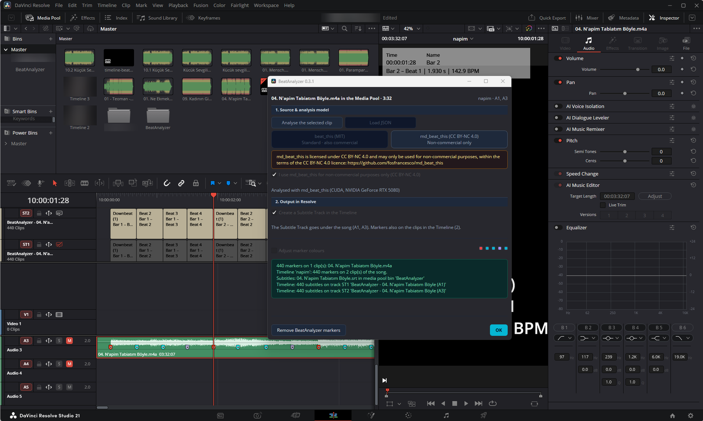
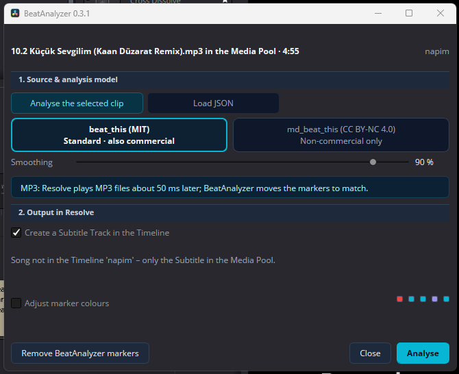
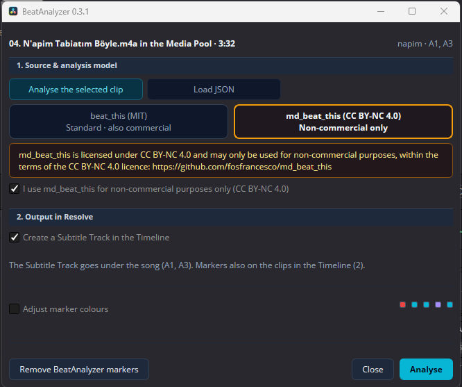
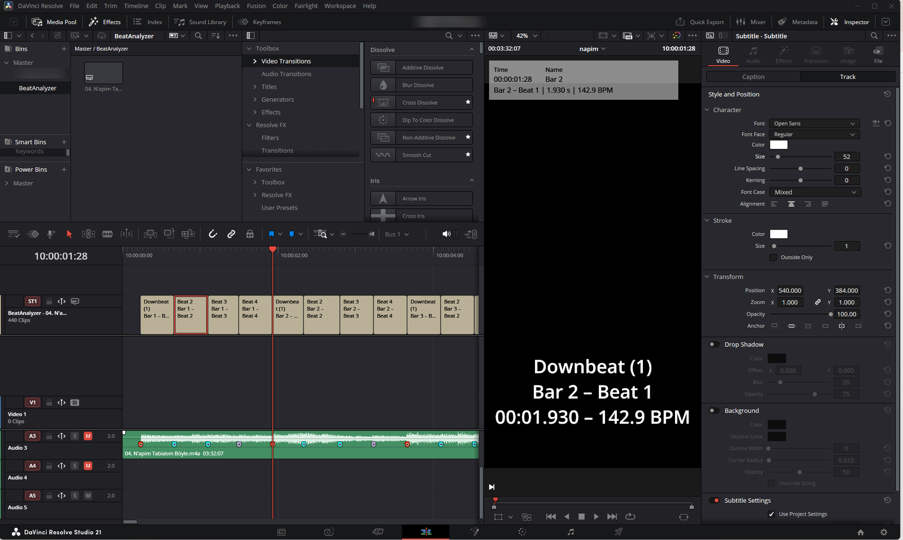
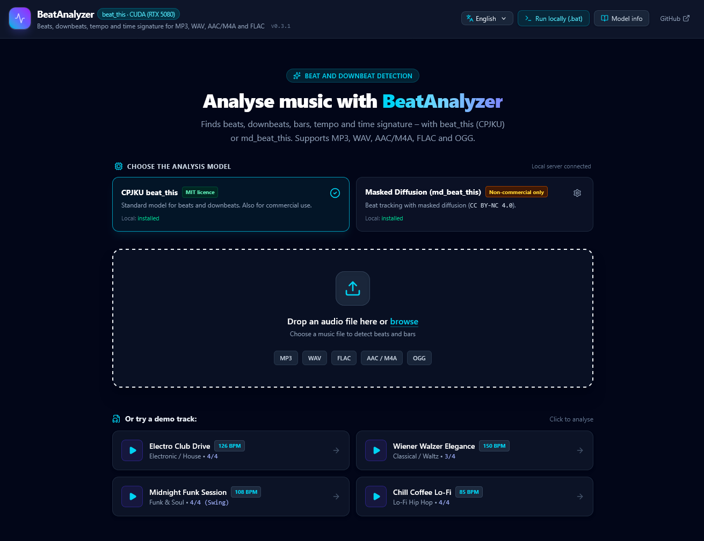
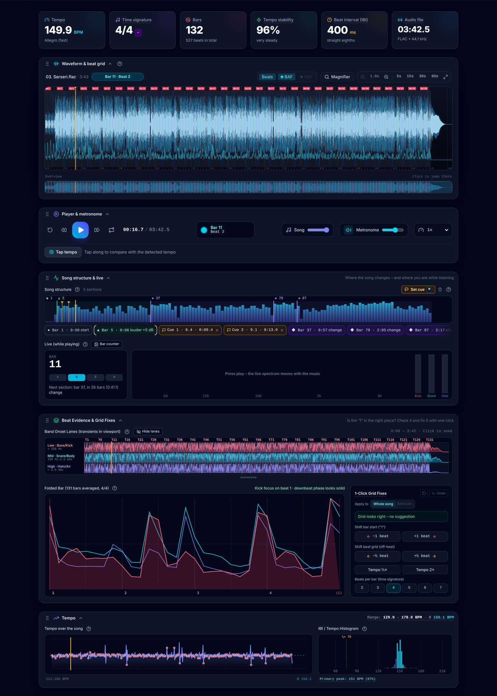

# BeatAnalyzer

**Version 0.3.1** · [Changelog](CHANGELOG.md) · [Lizenz](LICENSE) · [English](README.md) · **Deutsch** · [Türkçe](README.tr.md)

BeatAnalyzer erkennt in einem Song **Beats, Downbeats, Tempo und Taktart** und bringt sie nach
**DaVinci Resolve** – als **farbige Marker auf deinem Audio-Clip** und als **Subtitle Track** unter dem Song. Die
Analyse läuft lokal auf deinem PC mit dem Transformer-Modell [CPJKU beat_this](https://github.com/CPJKU/beat_this).
Du startest sie direkt aus einem Fenster in Resolve oder nutzt die Web-App im Browser.



---

## Inhalt

- [Funktionen](#funktionen)
- [Voraussetzungen](#voraussetzungen)
- [Installation (Windows)](#installation-windows)
- [Installation (Linux / macOS)](#installation-linux--macos)
- [DaVinci Resolve](#davinci-resolve)
- [Web-App](#web-app)
- [Export](#export)
- [Sprachen](#sprachen)
- [Update](#update)
- [Kommandozeile](#kommandozeile)
- [Fehlersuche](#fehlersuche)
- [Aufbau des Projekts](#aufbau-des-projekts)
- [Entwicklung](#entwicklung)
- [Modelle und Lizenzen](#modelle-und-lizenzen)
- [Credits](#credits)

---

## Funktionen

- **Beat- und Downbeat-Erkennung** mit CPJKU beat_this (PyTorch, auf einer NVIDIA-Grafikkarte über CUDA oder auf
  der CPU). Ohne beat_this rechnet BeatAnalyzer mit librosa. Optional ein zweites Modell:
  [md_beat_this](https://github.com/fosfrancesco/md_beat_this) – **nur für nicht-kommerzielle Zwecke**
  (CC BY-NC 4.0).
- **Analyse direkt aus DaVinci Resolve:** Clip auswählen, *Analysieren* drücken – Marker und Subtitles kommen von
  selbst.
- **Marker auf dem Clip** im Media Pool und auf den Clips des Songs in der offenen Timeline, je Beat des Takts eine
  Farbe. Die Marker-Notiz nennt Takt, Beat, Zeit, Tempo und Confidence.
- **Subtitle Track unter dem Song** – ein Subtitle je Beat (Takt, Beat, Zeit, Tempo), ein Track je Audiospur, auf
  der der Song liegt.
- **Gleichmäßiges Taktraster („Glätten“):** beat_this entscheidet jeden Downbeat für sich; Intros und Breaks
  bekommen so Takte mit 2 oder 3 Beats. Glätten legt ein gleichmäßiges Raster darüber und setzt nur dort neu an, wo
  das Modell klar eine neue „1“ hört. Die Beats selbst ändern sich nie.
- **Web-App:** Tempo, Taktart, Taktanzahl, Tempo-Stabilität; detaillierte Wellenform mit Beat-Raster und den Kurven
  für Beats und Downbeats, Zoom, Loop, Player mit Metronom und Tap-Tempo, Tempo-Kurve, Beat-Tabelle zum Korrigieren.
- **Exporte:** Marker-JSON für Resolve, Audacity-Textmarken, JSON, MIDI-Klickspur, CSV.
- **Formate:** MP3, WAV, FLAC, OGG, AAC/M4A, ALAC, Opus, WMA und mehr. MP3-Dateien werden um die Verzögerung
  verschoben, mit der Resolve sie abspielt (etwa 50 ms), damit die Marker auf dem Beat liegen.
- **Englisch, Deutsch, Türkisch** – Web-App und Resolve-Fenster.
- **Update von GitHub** mit einem Klick.

## Voraussetzungen

| Was | Version | Hinweis |
|---|---|---|
| Windows | 10 oder 11 | Linux und macOS gehen auch, siehe unten |
| Python | 3.10 bis 3.13 | Beim Installer das Häkchen bei *Add python.exe to PATH* setzen |
| Git | beliebig | Für die Installation von beat_this. Ohne Git rechnet BeatAnalyzer mit librosa |
| NVIDIA-Grafikkarte | optional | Beschleunigt beat_this. Ohne läuft es auf der CPU |
| DaVinci Resolve **Studio** | 21 | Nur für das Resolve-Fenster. Die kostenlose Version erlaubt keine Skripte mit Fenster und Dateizugriff (siehe [Fehlersuche](#fehlersuche)) |
| Speicherplatz | ca. 5 GB | Hauptsächlich PyTorch im Ordner `venv\` |

Node.js brauchst du nicht: Die Web-App liegt fertig gebaut in `dist/`.

## Installation (Windows)

1. **Herunterladen:** [BeatAnalyzer.zip](https://github.com/fardem/beatanalyzer/releases/latest/download/BeatAnalyzer.zip)
   vom neuesten Release.
2. **Entpacken:** Rechtsklick auf die ZIP → *Alle extrahieren*. Am besten in einen Ordner ohne Leerzeichen, z. B.
   `C:\BeatAnalyzer`.
3. **Doppelklick auf `install_and_run.bat`.** Windows warnt eventuell, weil die Datei aus dem Internet kommt:
   *Weitere Informationen* → *Trotzdem ausführen*.

`install_and_run.bat`:

- sucht Python,
- legt die eigene Umgebung `venv\` im BeatAnalyzer-Ordner an – das übrige System bleibt unverändert,
- installiert NumPy, SciPy, librosa, soundfile, PyAV, PyTorch und beat_this,
- lädt das Modell von beat_this vorab,
- installiert das Skript in DaVinci Resolve, wenn Resolve auf dem PC ist,
- startet den Server und öffnet <http://localhost:8000>, sobald er bereit ist.

Der erste Lauf dauert einige Minuten (PyTorch ist ca. 2 GB groß). Das Protokoll steht in `install_log.txt`.

**Danach** startest du BeatAnalyzer mit `start.bat`. Beenden: im schwarzen Fenster `Strg + C` oder das Fenster
schließen.

**Deinstallieren:** den BeatAnalyzer-Ordner löschen. Das Resolve-Skript liegt unter
`%APPDATA%\Blackmagic Design\DaVinci Resolve\Support\Fusion\Scripts\Utility\BeatAnalyzer_Markers.lua`.

## Installation (Linux / macOS)

```bash
./install_and_run.sh
```

Das Skript legt `venv/` an, installiert die Pakete aus `requirements.txt`, installiert das Resolve-Skript, wenn
Resolve gefunden wird, und startet den Server auf <http://localhost:8000>.

## DaVinci Resolve

### Skript installieren

`install_and_run.bat` und jedes Update installieren das Skript selbst. In der Web-App geht es auch:
*Exportieren → DaVinci Resolve → In Resolve installieren* (bzw. *In Resolve aktualisieren*, wenn eine ältere
Version installiert ist). Danach Resolve einmal neu starten.

Öffnen mit **Workspace → Scripts → BeatAnalyzer_Markers**.

### Das Fenster



Oben stehen der Song und die offene Timeline. Darunter:

**1. Quelle & Analyse-Modell** – zwei Wege:

- **Ausgewählten Clip analysieren:** einen Audio-Clip im Media Pool auswählen und **Analysieren** drücken. Die
  Analyse läuft im Hintergrund; du kannst sie abbrechen, bis die Marker gesetzt werden. Bis dahin ändert sich nichts
  in deinem Projekt.
- **JSON laden:** eine aus der Web-App exportierte Marker-JSON nehmen und **Marker setzen** drücken.

Wähle das **Modell**: *beat_this (MIT)* – Standard, auch für kommerzielle Arbeiten – oder *md_beat_this
(CC BY-NC 4.0)* – nur nicht-kommerziell. Bei md_beat_this zeigt das Fenster die Lizenz, und du musst das Häkchen
setzen, bevor du analysieren kannst:



**Glätten** (0 % = aus … 100 %, Standard 90 %) bestimmt, wie gleichmäßig die Takte eingeteilt werden (siehe
[Funktionen](#funktionen)). md_beat_this liefert keine Wahrscheinlichkeiten je Frame, deshalb ist der Regler dort
ausgeblendet.

**2. Ausgabe in Resolve**

- **Subtitle Track in der Timeline anlegen:** Liegt der Song auf einer Audiospur der offenen Timeline, kommt
  darunter ein Subtitle Track „BeatAnalyzer - &lt;Song&gt;“ – einer je Audiospur, auf der der Song liegt.
- **Markerfarben anpassen:** je eine Farbe für Downbeat, Beat 2, 3, 4 und übrige Beats – oder kein Marker. Die
  kleinen Quadrate zeigen die aktuellen Farben.

**Hinweise** erscheinen in farbigen Kästen: blau für Informationen (z. B. die MP3-Verzögerung), bernsteinfarben für
die Lizenz von md_beat_this und für Rückfragen, rot für Fehler, grün für das Ergebnis.

**BeatAnalyzer-Marker entfernen** entfernt nach einer Rückfrage die Marker, Subtitle Tracks und Subtitle-Clips von
BeatAnalyzer. Marker, die du von Hand gesetzt hast, bleiben.

Das Fenster merkt sich Weg, Modell, Glätten und Farben. Das Häkchen für md_beat_this wird jedes Mal neu abgefragt.

### Was du bekommst



- **Marker auf dem Audio-Clip im Media Pool** – sie erscheinen bei jeder Verwendung des Clips in jeder Timeline –
  und auf den Clips des Songs in der offenen Timeline, auch auf vorne gekürzten Clips. Standardfarben: **Rot** =
  Downbeat, **Cyan** = Beat 2–4. Die Marker-Notiz lautet z. B. `Takt 2 – Beat 1 | 1,930 s | 142,9 BPM`.
- **Subtitles:** die Datei `<Song>.srt` im Media-Pool-Ordner **BeatAnalyzer** und auf dem Subtitle Track ein Subtitle
  je Beat:

  ```
  Downbeat (1)
  Takt 2 – Beat 1
  00:01,930 – 142,9 BPM
  ```

  Der erste Subtitle nennt Datei, Tempo, Taktart, Modell und dessen Lizenz.
- Ein neuer Lauf ersetzt die Marker und Tracks des letzten Laufs.

**MP3:** Resolve spielt die meisten MP3-Dateien etwa 50 ms später ab, als sie analysiert werden (es überspringt die
Encoder-Verzögerung am Anfang nicht). BeatAnalyzer liest die genaue Verzögerung aus der Datei und verschiebt Marker
und Subtitles um diesen Wert; das Fenster zeigt es vorher und nachher an. MP3-Dateien ohne diese Verzögerung
brauchen keinen Ausgleich – das Fenster sagt es dann.

## Web-App

`start.bat` öffnet die Web-App unter <http://localhost:8000>.



1. **Modell wählen** – beat_this oder md_beat_this (fragt einmal je Sitzung nach der Lizenz).
2. **Audiodatei hineinziehen** oder auf *durchsuchen* klicken. Die Kopfzeile zeigt, womit analysiert wird, z. B.
   `beat_this · CUDA (RTX 5080)`.
3. **Ergebnis prüfen:**



- **Kacheln:** Tempo, Taktart (mit dem Anteil der Takte, die sie haben), Taktanzahl, Tempo-Stabilität,
  Beat-Abstand, Audiodatei. Der Regler **Glätten** in der Kachel Taktart rechnet die Takte sofort neu.
- **Wellenform & Beat-Raster:** Takte und Beats als Linien, die Kurven des Modells für Beats (BAF) und Downbeats
  (DAF). Schnellzoom 5 s / 15 s / 30 s / 60 s, Lupe, Übersicht mit verschiebbarem Rahmen.
- **Player:** Wiedergabe ab jeder Stelle, **Loop** (grau = aus, gelb A-B = Ausschnitt im blauen Rahmen, grün =
  ganzer Song), Lautstärke des Songs, **Metronom** auf den erkannten Beats (höherer Klick auf dem Downbeat),
  Geschwindigkeit 0,5× bis 1,5×, Tap-Tempo.
- **Tempo-Kurve** über den ganzen Song.
- **Beat-Tabelle:** einen Beat um ±10 ms verschieben oder zum Downbeat machen (`1/X`); die Korrekturen gehen in
  alle Exporte.

4. **Exportieren** – Knopf oben rechts.

Ohne den Python-Server (z. B. nur `npm run dev`) rechnet der Browser selbst, mit sichtbarem Hinweis – das Ergebnis
ist deutlich ungenauer als mit beat_this.

## Export

| Format | Datei | Wofür |
|---|---|---|
| DaVinci Resolve | `<Name>_resolve_markers.json` | Weg *JSON laden* im Resolve-Fenster |
| Audacity | `<Name>_audacity_labels.txt` | *Datei → Importieren → Textmarken* |
| beat_this JSON | `<Name>_beat_this.json` | alle Werte, z. B. für eigene Skripte |
| MIDI | `<Name>_click_track.mid` | Klickspur für eine DAW |
| CSV | `<Name>_beats.csv` | Tabelle mit Zeit, Takt, Beat, Tempo |

## Sprachen

Web-App und Resolve-Fenster sprechen **Englisch, Deutsch und Türkisch**. Die Sprache wählst du in der Kopfzeile der
Web-App; sie wird gespeichert und gilt auch für das Resolve-Fenster (einmal *In Resolve aktualisieren* klicken und
Resolve neu starten). Begriffe aus Resolve (Marker, Subtitle Track, Media Pool …) sowie *Beat, Downbeat,
Confidence* bleiben in jeder Sprache englisch. Alles andere, was das Programm ausgibt (Server, Konsole,
Kommandozeile, Skripte), ist englisch.

## Update

Gibt es auf GitHub eine neue Version, zeigt die Kopfzeile der Web-App den Knopf **Update x.y.z**. Oder
`update.bat` doppelklicken.

Das Update:

- lädt `BeatAnalyzer.zip` des neuesten Releases,
- legt jede ersetzte Datei in `update-backup\<alte Version>\` ab,
- lässt `venv\` unverändert und installiert Python-Pakete nur, wenn sich `requirements.txt` geändert hat,
- aktualisiert ein installiertes Resolve-Skript.

Danach BeatAnalyzer neu starten (`start.bat`). Ein mit `git clone` angelegter Ordner wird nicht überschrieben;
dort `git pull` verwenden.

## Kommandozeile

Unter Windows eine Audiodatei auf `run_cli.bat` ziehen. Oder:

```bash
venv/bin/python backend/analyze_cli.py song.mp3
```

| Option | Wirkung |
|---|---|
| `--export-json PFAD` | JSON mit allen Werten (Standard: `<Name>_beat_this.json`) |
| `--export-resolve PFAD` | Marker-JSON für Resolve (Standard: `<Name>_resolve_markers.json`) |
| `--only-downbeats` | Resolve-Marker nur auf Downbeats |
| `--export-audacity PFAD` | Audacity-Textspur |
| `--export-csv PFAD` | CSV-Tabelle |
| `--model beat_this\|md_beat_this` | Analyse-Modell (`md_beat_this` nur nicht-kommerziell, CC BY-NC 4.0) |
| `--no-smooth-bars` | Takte wie von beat_this (ohne Glätten) |
| `--protect 0…1` | Stärke des Glättens (Standard 0.95 ≈ 90 % im Fenster) |
| `--ffmpeg-dir PFAD` | Ordner mit `ffmpeg`, falls es nicht im `PATH` liegt |

Unter Windows heißt der Python-Pfad `venv\Scripts\python.exe`.

## Fehlersuche

| Meldung / Verhalten | Ursache | Lösung |
|---|---|---|
| „'python' is not recognized …“ | Python ist nicht im PATH | Python-Installer → *Modify* → *Add Python to environment variables* |
| Kopfzeile zeigt „librosa (fallback) – beat_this not installed“ | beat_this fehlt, meist weil Git fehlte | Git installieren, `install_and_run.bat` erneut starten |
| `BeatAnalyzer_Markers` fehlt unter *Workspace → Scripts* | Resolve wurde nach der Installation nicht neu gestartet | Resolve neu starten; sonst *In Resolve installieren* in der Web-App |
| „Python of BeatAnalyzer not found“ im Resolve-Fenster | das Skript wurde von Hand kopiert statt installiert | *In Resolve aktualisieren* in der Web-App (nur der Installer trägt BeatAnalyzer-Ordner und Python ins Skript ein) |
| In Resolve passiert nichts (kostenlose Version) | Resolve (kostenlos) erlaubt keine Skript-Fenster und keinen Dateizugriff | DaVinci Resolve Studio verwenden |
| „Die FLAC-Datei … beginnt mit einem ID3-Tag“ | ein Tag-Programm hat einen MP3-Tag vor die FLAC-Daten geschrieben; Browser und Resolve lehnen solche Dateien ab | Tag entfernen, z. B. `ffmpeg -i "song.flac" -map 0 -c copy neu.flac` |
| Update meldet „No release found“ | noch kein Release, oder das Repository ist privat | bei privatem Repository `BEATANALYZER_GITHUB_TOKEN` mit einem Lese-Token setzen |

`debug_system.bat` schreibt einen Diagnosebericht nach `debug_report.txt` (Python, Pakete, Grafikkarte).

## Aufbau des Projekts

| Pfad | Aufgabe |
|---|---|
| `install_and_run.bat` / `.sh` | Erstinstallation und Start |
| `start.bat` | Start ohne Installation |
| `update.bat` | Update von GitHub |
| `run_cli.bat` | Analyse per Drag & Drop auf die Datei |
| `debug_system.bat` | Diagnosebericht |
| `backend/server.py` | HTTP-Server: liefert `dist/` aus, `/api/analyze`, `/api/settings`, `/api/resolve/*`, `/api/update/*` |
| `backend/analyzer.py` | Analyse mit beat_this, md_beat_this oder librosa; Glätten der Takte; Marker-JSON für Resolve |
| `backend/resolve_job.py` | Analyse, die das Resolve-Fenster startet |
| `backend/mp3_offset.py` | Verzögerung, mit der Resolve ein MP3 abspielt |
| `backend/analyze_cli.py` | Kommandozeile |
| `backend/resolve_plugin.py` | installiert das Resolve-Skript (Sprache, Ordner, Python) |
| `backend/updater.py` | Update aus dem neuesten GitHub-Release |
| `lang/*.json` | Texte auf Englisch, Deutsch und Türkisch (Web-App und Resolve-Fenster) |
| `resolve/BeatAnalyzer_Markers.lua` | Skript und Fenster für DaVinci Resolve |
| `src/` | Web-App (React, TypeScript) |
| `dist/` | gebaute Web-App; wird mit eingecheckt |
| `VERSION` | Versionsnummer für App, Skript und Release |

## Entwicklung

Web-App bauen nach Änderungen in `src/` oder `lang/` (`dist/` wird mit eingecheckt):

```bash
npm install
npm run build
```

Prüfen:

```bash
npm run lint
```

```bash
venv/bin/python -m unittest discover -s backend/tests -v
```

Die Tests des Lua-Skripts laufen gegen einen nachgebauten Resolve und brauchen das Paket `lupa`
(`pip install lupa`); ohne `lupa` werden sie übersprungen. Sie ersetzen keinen Test in Resolve.

**Release:** Version in `VERSION`, `package.json`, `package-lock.json`, den READMEs und `local VERSION` in
`resolve/BeatAnalyzer_Markers.lua` und `resolve/BeatThis_Markers.lua` anheben, CHANGELOG ergänzen, einen Tag mit der
Versionsnummer pushen (z. B. `0.3.1`). Der Workflow `.github/workflows/release.yml` hängt `BeatAnalyzer.zip` an das
Release.

## Modelle und Lizenzen

BeatAnalyzer selbst enthält **kein Modell** und bietet keins zum Download an:

- `install_and_run.bat` installiert das Python-Paket **beat_this** von GitHub (<https://github.com/CPJKU/beat_this>).
- beat_this lädt sein Modell `final0` **direkt beim Anbieter** (Server der Johannes Kepler Universität Linz) in den
  Cache von PyTorch (`%USERPROFILE%\.cache\torch\hub\checkpoints\beat_this-final0.ckpt`). `install_and_run.bat`
  stößt diesen Download vorab an und nennt die Ursache, wenn er scheitert.
- BeatAnalyzer **verändert das Modell nicht**; es nutzt die Wahrscheinlichkeiten, die beat_this ausgibt, und teilt
  daraus die Takte ein (Glätten).

| Modell | Lizenz | Kommerzielle Nutzung |
|---|---|---|
| beat_this (`final0`), Code und veröffentlichte Gewichte | MIT | erlaubt |
| md_beat_this (optional, von Hand installiert) | CC BY-NC 4.0 | **nicht erlaubt** |
| librosa (Ersatz ohne beat_this) | ISC | erlaubt |

Hinweis der Autoren von beat_this: Einige der Trainingsdaten sind urheberrechtlich geschützt oder stehen unter
eingeschränkten Creative-Commons-Lizenzen. Ob das deine Nutzung betrifft, musst du selbst prüfen. Diese Übersicht
ist keine Rechtsberatung.

Jede Subtitle-Datei von BeatAnalyzer nennt das Modell und seine Lizenz, z. B.
„Model: beat_this – Nutzung im Rahmen der MIT-Lizenz“.

### md_beat_this (optional, nur nicht-kommerziell)

BeatAnalyzer enthält **weder Code noch Gewichte** von md_beat_this und lädt es auch nicht herunter. Wer es für
nicht-kommerzielle Zwecke nutzen will, installiert es in die Umgebung von BeatAnalyzer (es braucht zusätzlich
`ffmpeg`; den Ordner kannst du in der Web-App oder mit `--ffmpeg-dir` angeben):

```bash
venv\Scripts\pip install https://github.com/fosfrancesco/md_beat_this/archive/main.zip
```

Unter Linux / macOS:

```bash
venv/bin/pip install https://github.com/fosfrancesco/md_beat_this/archive/main.zip
```

Danach BeatAnalyzer neu starten. Ergebnisse von md_beat_this tragen Lizenz und Namensnennung in ihren JSON-Dateien
und Subtitles.

## Credits

**CPJKU beat_this** – Beat- und Downbeat-Erkennung, Johannes Kepler Universität Linz,
<https://github.com/CPJKU/beat_this>. Code und Modellgewichte unter der MIT-Lizenz. Wenn du beat_this in einer
wissenschaftlichen Arbeit verwendest, zitiere bitte:

```bibtex
@inproceedings{foscarin2024beatthis,
    author = {Francesco Foscarin and Jan Schl{\"u}ter and Gerhard Widmer},
    title = {Beat this! Accurate beat tracking without {DBN} postprocessing},
    year = 2024,
    month = nov,
    booktitle = {Proceedings of the 25th International Society for Music Information Retrieval Conference (ISMIR)},
    address = {San Francisco, CA, United States},
}
```

**Masked Diffusion (md_beat_this, optional)** – Francesco Foscarin, Filip Korzeniowski, Richard Vogl,
<https://github.com/fosfrancesco/md_beat_this>. Code, Gewichte, Vorhersagen und Aktivierungen unter
**CC BY-NC 4.0** (nicht-kommerzielle Nutzung mit Namensnennung).

Weitere Bibliotheken, die per pip installiert werden: PyTorch (BSD-3-Clause), librosa (ISC), NumPy und SciPy
(BSD-3-Clause), soundfile (BSD-3-Clause), PyAV (BSD-3-Clause; bringt FFmpeg-Bibliotheken mit, LGPL). Die Web-App in
`dist/` enthält React, React DOM, scheduler (MIT) und lucide-react (ISC); ihre Lizenztexte stehen in
[`dist/.vite/license.md`](dist/.vite/license.md).

BeatAnalyzer steht unter der [MIT-Lizenz](LICENSE).
