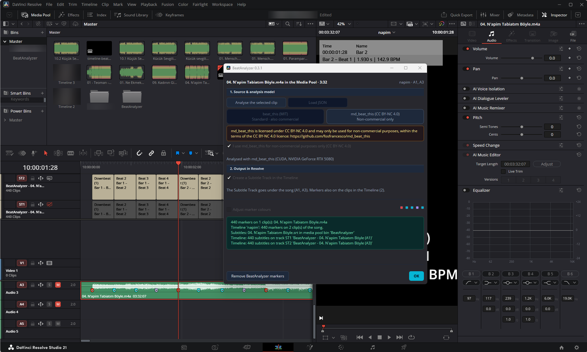
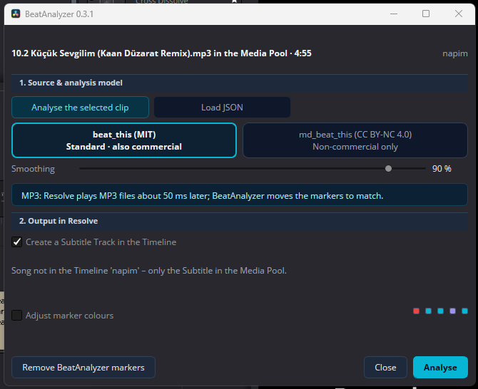
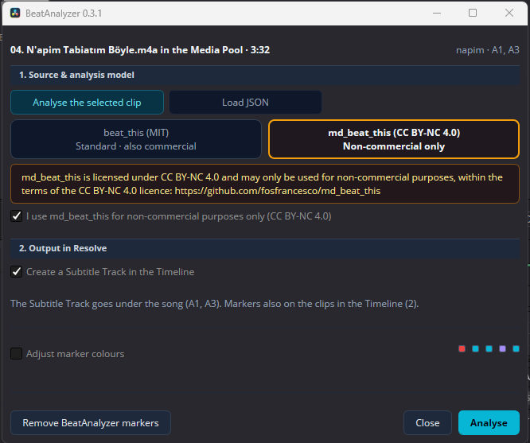
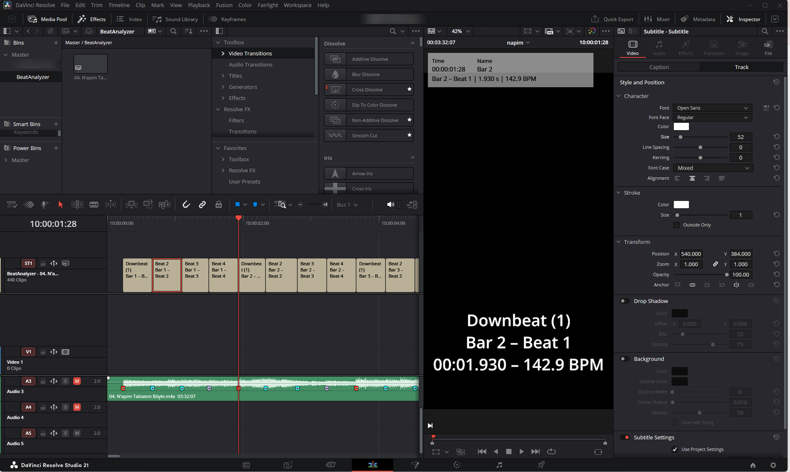
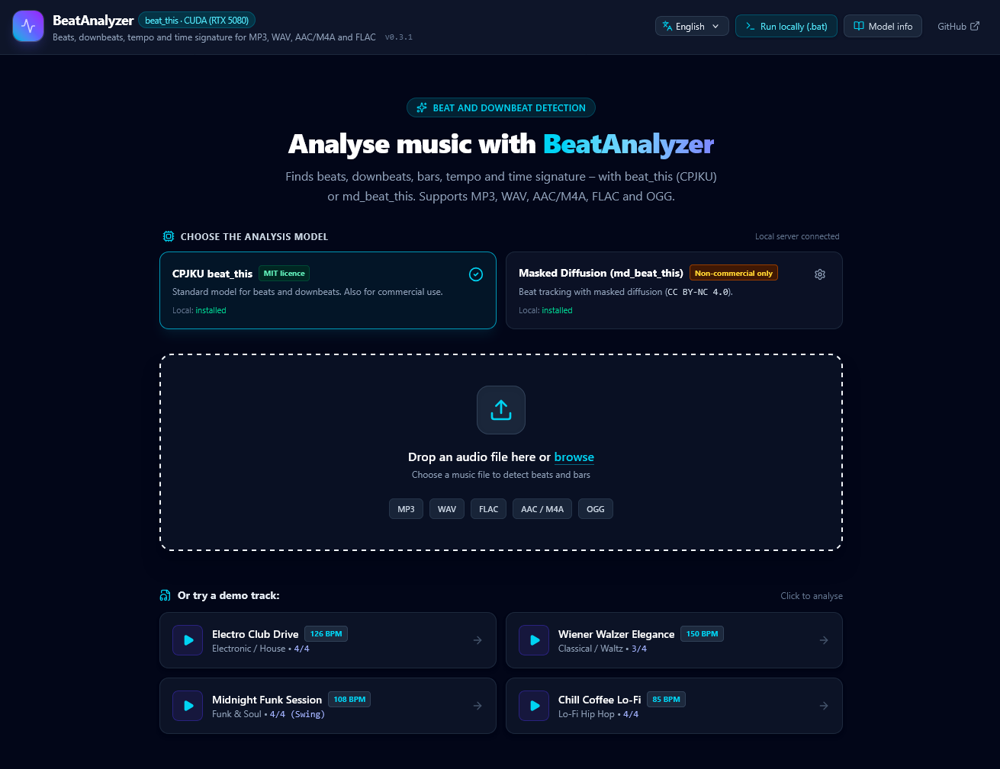
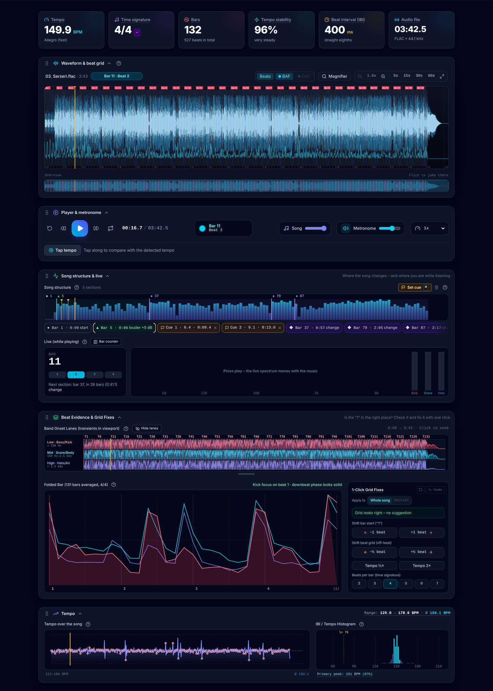

# BeatAnalyzer

**Version 0.4.1** · [Changelog](CHANGELOG.md) · [Licence](LICENSE) · **English** · [Deutsch](README.de.md) · [Türkçe](README.tr.md)

BeatAnalyzer finds the **beats, downbeats, tempo and time signature** of a song and puts them into
**DaVinci Resolve** as **coloured markers on your audio clip** and as a **subtitle track** under the song. The
analysis runs locally on your PC with the transformer model [CPJKU beat_this](https://github.com/CPJKU/beat_this).
You can start it straight from a window inside Resolve, or use the web app in your browser.



## Why BeatAnalyzer

- **Bars, not just beats:** every beat knows its bar and its place in the bar. Downbeats come from the model
  itself, and the time signature comes with the share of bars that really have it.
- **An even bar grid you control:** Smoothing keeps the "1" where the music has it, also through intros and breaks,
  and you choose how strictly.
- **Markers you can read:** one colour per beat of the bar, and every marker note says bar, beat, time, tempo and
  confidence. Subtitles under the song show the same while you edit.
- **Exact in Resolve:** markers on the clip and on every use in the timeline, also on trimmed clips; MP3 files are
  shifted by the delay with which Resolve plays them.
- **Your choice of model:** beat_this (MIT, also for commercial work) or md_beat_this for non-commercial projects.
- **Check before you cut:** waveform with beat grid, model curves, loop, metronome on the detected beats and a beat
  table to correct single beats.
- **Fix the grid in one click:** the folded bar shows where kick and snare really sit in the bar; BeatAnalyzer
  suggests the fix (bar start, half beat, tempo, time signature) with a preview – for the whole song or a section,
  undoable, and kept when you change Smoothing.
- **Local and private:** everything runs on your PC; no upload, no account.

---

## Contents

- [Why BeatAnalyzer](#why-beatanalyzer)
- [Features](#features)
- [Requirements](#requirements)
- [Installation (Windows)](#installation-windows)
- [Installation (Linux / macOS)](#installation-linux--macos)
- [DaVinci Resolve](#davinci-resolve)
- [Web app](#web-app)
- [Export](#export)
- [Languages](#languages)
- [Update](#update)
- [Command line](#command-line)
- [Troubleshooting](#troubleshooting)
- [Project structure](#project-structure)
- [Development](#development)
- [Models and licences](#models-and-licences)
- [Credits](#credits)

---

## Features

- **Beat and downbeat detection** with CPJKU beat_this (PyTorch, on an NVIDIA graphics card via CUDA or on the
  CPU). Without beat_this, BeatAnalyzer falls back to librosa. Optional second model:
  [md_beat_this](https://github.com/fosfrancesco/md_beat_this) – **non-commercial use only** (CC BY-NC 4.0).
- **Analysis straight from DaVinci Resolve:** select a clip, press *Analyse* – markers and subtitles follow.
- **Markers on the clip** in the Media Pool and on the song's clips in the open timeline, one colour per beat of the
  bar. The marker note gives bar, beat, time, tempo and confidence.
- **Subtitle track under the song** – one subtitle per beat (bar, beat, time, tempo), one track per audio track the
  song is on.
- **Even bar grid ("Smoothing"):** beat_this decides every downbeat on its own, so intros and breaks can get bars
  of 2 or 3 beats. Smoothing lays an even grid over them and restarts it only where the model clearly hears a new
  "1". The beats themselves never change.
- **Web app:** tempo, time signature, number of bars, tempo stability; detailed waveform with beat grid and beat /
  downbeat curves, zoom, loop, player with metronome and tap tempo, tempo curve, beat table for corrections.
- **Exports:** marker JSON for Resolve, Audacity labels, JSON, MIDI click track, CSV.
- **Formats:** MP3, WAV, FLAC, OGG, AAC/M4A, ALAC, Opus, WMA and more. MP3 files are shifted by the delay with which
  Resolve plays them (about 50 ms), so the markers sit on the beat.
- **English, German, Turkish** – web app and Resolve window.
- **Update from GitHub** with one click.

## Requirements

| What | Version | Note |
|---|---|---|
| Windows | 10 or 11 | Linux and macOS work too, see below |
| Python | 3.10 to 3.13 | Tick *Add python.exe to PATH* in the installer |
| Git | any | Needed to install beat_this. Without Git BeatAnalyzer uses librosa |
| NVIDIA graphics card | optional | Makes beat_this much faster. The installer picks the CUDA build of PyTorch when the driver supports CUDA 12.8 or newer (RTX 50 cards need it); without it, it runs on the CPU |
| DaVinci Resolve **Studio** | 21 | Only for the Resolve window. The free version does not allow scripts with windows and file access (see [Troubleshooting](#troubleshooting)) |
| Disk space | about 5 GB | Mostly PyTorch in the folder `venv\` |

You do not need Node.js: the web app is shipped ready-built in `dist/`.

**Tested with** Windows, Python 3.13, PyTorch 2.8.0+cu128, NVIDIA GeForce RTX 5080 (driver 621.24) and DaVinci
Resolve Studio 21 – all package versions are in [docs/tested-environment.md](docs/tested-environment.md).

## Installation (Windows)

1. **Download** [BeatAnalyzer.zip](https://github.com/fardem/beatanalyzer/releases/latest/download/BeatAnalyzer.zip)
   from the latest release.
2. **Unpack** it: right-click the ZIP → *Extract All*. A folder without spaces is best, e.g. `C:\BeatAnalyzer`.
3. **Double-click `install_and_run.bat`.** Windows may warn because the file comes from the internet:
   *More info* → *Run anyway*.

`install_and_run.bat`:

- looks for Python,
- creates its own environment `venv\` in the BeatAnalyzer folder – the rest of your system stays untouched,
- installs NumPy, SciPy, librosa, soundfile, PyAV, PyTorch and beat_this – PyTorch as the **CUDA build** when an
  NVIDIA card with a recent driver is found, otherwise the CPU build (a CPU build from an older installation is
  replaced; a working CUDA build is kept),
- downloads the beat_this model in advance,
- installs the script in DaVinci Resolve if Resolve is on the PC,
- starts the server and opens <http://localhost:8000> as soon as it is ready.

The first run takes a few minutes (PyTorch is about 2 GB). The log is in `install_log.txt`.

**After that**, start BeatAnalyzer with `start.bat`. To stop it, press `Ctrl + C` in the black window or close it.

**Uninstall:** delete the BeatAnalyzer folder. The Resolve script is
`%APPDATA%\Blackmagic Design\DaVinci Resolve\Support\Fusion\Scripts\Utility\BeatAnalyzer_Markers.lua`.

## Installation (Linux / macOS)

```bash
./install_and_run.sh
```

The script creates `venv/`, installs the packages from `requirements.txt`, installs the Resolve script if Resolve is
found and starts the server on <http://localhost:8000>.

## DaVinci Resolve

### Install the script

`install_and_run.bat` and every update install the script for you. You can also do it in the web app:
*Export → DaVinci Resolve → Install in Resolve* (or *Update in Resolve* when an older version is installed). Then
restart Resolve once.

Open it with **Workspace → Scripts → BeatAnalyzer_Markers**.

### The window



At the top you see the song and the open timeline. Below:

**1. Source & analysis model** – two ways:

- **Analyse the selected clip:** select one audio clip in the Media Pool and press **Analyse**. The analysis runs in
  the background; you can cancel it until the markers are being set. Nothing in your project changes before that.
- **Load JSON:** use a marker JSON exported from the web app and press **Apply markers**.

Choose the **model**: *beat_this (MIT)* – the standard, also for commercial work – or *md_beat_this
(CC BY-NC 4.0)* – non-commercial only. For md_beat_this the window shows the licence and you must tick the box
before you can analyse:



**Smoothing** (0 % = off … 100 %, default 90 %) sets how evenly the bars are laid out (see [Features](#features)).
md_beat_this gives no per-frame probabilities, so the slider is hidden there.

**2. Output in Resolve**

- **Create a Subtitle Track in the Timeline:** if the song is on an audio track of the open timeline, a subtitle
  track "BeatAnalyzer - &lt;song&gt;" goes under it – one per audio track the song is on.
- **Adjust marker colours:** one colour each for the downbeat, beats 2, 3, 4 and other beats – or no marker. The
  small squares show the current colours.

**Notes** appear in coloured boxes: blue for information (e.g. the MP3 delay), amber for the licence of md_beat_this
and for questions, red for errors, green for the result.

**Remove BeatAnalyzer markers** removes the markers, subtitle tracks and subtitle clips of BeatAnalyzer after asking
you. Markers you set by hand stay.

The window remembers the way, model, smoothing and colours. The licence box for md_beat_this is asked again every
time.

### What you get



- **Markers on the audio clip in the Media Pool** – they show on every use of the clip in every timeline – and on
  the song's clips in the open timeline, also on clips trimmed at the start. Default colours: **red** = downbeat,
  **cyan** = beats 2–4. The marker note reads e.g. `Bar 2 – Beat 1 | 1.930 s | 142.9 BPM`.
- **Subtitles:** the file `<song>.srt` in the Media Pool bin **BeatAnalyzer**, and on the subtitle track one
  subtitle per beat:

  ```
  Downbeat (1)
  Bar 2 – Beat 1
  00:01.930 – 142.9 BPM
  ```

  The first subtitle names the file, tempo, time signature, model and its licence.
- A new run replaces the markers and tracks of the last run.

**MP3:** Resolve plays most MP3 files about 50 ms later than they are analysed (it does not drop the encoder delay
at the start). BeatAnalyzer reads the exact delay from the file and moves markers and subtitles by that much; the
window shows it before and after. MP3 files without that delay need no correction – the window says so.

## Web app

`start.bat` opens the web app at <http://localhost:8000>.



1. **Choose the model** – beat_this or md_beat_this (asks once per session to confirm the licence).
2. **Drop an audio file** or click *browse*. The header shows which program analyses, e.g.
   `beat_this · CUDA (RTX 5080)`.
3. **Check the result:**



- **Tiles:** tempo, time signature (with the share of bars that have it), number of bars, tempo stability, beat
  interval, audio file. The **Smoothing** slider in the time signature tile recomputes the bars at once.
- **Waveform & beat grid:** bars and beats as lines, the beat (BAF) and downbeat (DAF) curves of the model.
  Quick zoom 5 s / 15 s / 30 s / 60 s, magnifier, overview with a frame you can drag.
- **Player:** play from any point, **loop** (grey = off, yellow A-B = the section in the blue frame, green = the
  whole song), song volume, **metronome** on the detected beats (higher click on the downbeat), speed 0.5× to 1.5×,
  tap tempo.
- **Beat evidence & grid fixes:** band lanes for kick (< 150 Hz), snare/body and hi-hats, in step with the zoom
  of the waveform (drag the grip below them up to twice the height); the **folded bar** lays all bars – of the
  section or the whole song – on top of each other and says whether the kick sits on the "1". **1-click fixes:**
  bar start ±1 beat, grid ±½ beat, tempo ½× / 2×, **beats per bar** (2–7); undo and reset. A **suggestion** tries
  these fixes on the folded bar and offers the best one with a dashed preview – *Apply* takes it over. Fixes work on
  the **whole song or only the section** in the blue frame (e.g. ½× only where the model counted double). They stay
  when you move Smoothing and go into every export – also the marker JSON for Resolve.
- **Expert diagnostics** (click the title to open): spectrogram, energy spectrum of the "1", the other beats and
  the off-beats, **Live** spectrum while playing (flash on every beat, stronger on the "1"), tempo histogram.
- **Tempo curve** over the whole song (folded while the tempo is steady).
- **Beat table:** move a beat by ±10 ms or make it a downbeat (`1/X`); the corrections go into every export.

4. **Export** – button at the top right.

Without the Python server (e.g. only `npm run dev`) the browser analyses on its own, with a visible note – the
result is much less accurate than with beat_this.

## Export

| Format | File | For |
|---|---|---|
| DaVinci Resolve | `<name>_resolve_markers.json` | the way *Load JSON* in the Resolve window |
| Audacity | `<name>_audacity_labels.txt` | *File → Import → Labels* |
| beat_this JSON | `<name>_beat_this.json` | all values, e.g. for your own scripts |
| MIDI | `<name>_click_track.mid` | click track for a DAW |
| CSV | `<name>_beats.csv` | table with time, bar, beat, tempo |

## Languages

The web app and the Resolve window speak **English, German and Turkish**. Choose the language in the header of the
web app; it is saved and also used by the Resolve window (click *Update in Resolve* once and restart Resolve).
Terms of Resolve (marker, subtitle track, Media Pool …) and *beat, downbeat, confidence* stay English in every
language. Everything else the program prints (server, console, command line, scripts) is English.

## Update

When a new version is on GitHub, the header of the web app shows an **Update x.y.z** button. Or double-click
`update.bat`.

The update:

- downloads `BeatAnalyzer.zip` of the latest release,
- keeps every replaced file in `update-backup\<old version>\`,
- leaves `venv\` as it is and installs Python packages only when `requirements.txt` changed,
- updates an installed Resolve script.

Then restart BeatAnalyzer (`start.bat`). A folder created with `git clone` is not overwritten; use `git pull` there.

## Command line

On Windows, drag an audio file onto `run_cli.bat`. Or:

```bash
venv/bin/python backend/analyze_cli.py song.mp3
```

| Option | Effect |
|---|---|
| `--export-json PATH` | JSON with all values (default: `<name>_beat_this.json`) |
| `--export-resolve PATH` | marker JSON for Resolve (default: `<name>_resolve_markers.json`) |
| `--only-downbeats` | Resolve markers on downbeats only |
| `--export-audacity PATH` | Audacity label track |
| `--export-csv PATH` | CSV table |
| `--model beat_this\|md_beat_this` | analysis model (`md_beat_this` non-commercial only, CC BY-NC 4.0) |
| `--no-smooth-bars` | bars as beat_this gives them (no smoothing) |
| `--protect 0…1` | smoothing strength (default 0.95 ≈ 90 % in the window) |
| `--ffmpeg-dir PATH` | folder with an `ffmpeg` executable if it is not on the `PATH` |

On Windows the Python path is `venv\Scripts\python.exe`.

## Troubleshooting

| Message / behaviour | Cause | Fix |
|---|---|---|
| "'python' is not recognized …" | Python is not on the PATH | Python installer → *Modify* → *Add Python to environment variables* |
| Header shows "beat_this · CPU" although the PC has an NVIDIA card | the CPU build of PyTorch is installed (older installation) | run `install_and_run.bat` again: it installs the CUDA build. To keep a certain build: `set BEATANALYZER_TORCH=cpu` (or `cu126`, `cu128`) before running it |
| Header shows "librosa (fallback) – beat_this not installed" | beat_this is missing, usually because Git was missing | install Git, run `install_and_run.bat` again |
| `BeatAnalyzer_Markers` missing under *Workspace → Scripts* | Resolve was not restarted after the installation | restart Resolve; or *Install in Resolve* in the web app |
| "Python of BeatAnalyzer not found" in the Resolve window | the script was copied by hand, not installed | *Update in Resolve* in the web app (only the installer writes the BeatAnalyzer folder and Python into the script) |
| Nothing happens in Resolve (free version) | Resolve (free) does not allow script windows and file access | use DaVinci Resolve Studio |
| "The FLAC file … starts with an ID3 tag" | a tagging program wrote an MP3 tag in front of the FLAC data; browsers and Resolve refuse such files | remove the tag, e.g. `ffmpeg -i "song.flac" -map 0 -c copy fixed.flac` |
| Update reports "No release found" | no release yet, or the repository is private | for a private repository set `BEATANALYZER_GITHUB_TOKEN` to a read token |

`debug_system.bat` writes a diagnostic report to `debug_report.txt` (Python, packages, graphics card).

## Project structure

| Path | Purpose |
|---|---|
| `install_and_run.bat` / `.sh` | first installation and start |
| `start.bat` | start without installation |
| `update.bat` | update from GitHub |
| `run_cli.bat` | analysis by drag & drop onto the file |
| `debug_system.bat` | diagnostic report |
| `backend/server.py` | HTTP server: serves `dist/`, `/api/analyze`, `/api/settings`, `/api/resolve/*`, `/api/update/*` |
| `backend/analyzer.py` | analysis with beat_this, md_beat_this or librosa; bar smoothing; marker JSON for Resolve |
| `backend/resolve_job.py` | analysis started from the Resolve window |
| `backend/mp3_offset.py` | delay with which Resolve plays an MP3 |
| `backend/analyze_cli.py` | command line |
| `backend/resolve_plugin.py` | installs the Resolve script (language, folder, Python) |
| `backend/updater.py` | update from the latest GitHub release |
| `backend/torch_setup.py` | installs the right PyTorch build (CUDA or CPU) |
| `lang/*.json` | texts in English, German and Turkish (web app and Resolve window) |
| `resolve/BeatAnalyzer_Markers.lua` | script and window for DaVinci Resolve |
| `src/` | web app (React, TypeScript) |
| `src/utils/beatEvidence.ts` | band curves, folded bar, tempo histogram, spectra (web app) |
| `src/utils/beatTransforms.ts` | 1-click grid fixes as replayable steps, also for a section (web app) |
| `src/utils/fixSuggestion.ts` | suggestion: tries the fixes on the folded bar (web app) |
| `dist/` | built web app; checked in |
| `VERSION` | version number for app, script and release |

## Development

Build the web app after changes in `src/` or `lang/` (`dist/` is checked in):

```bash
npm install
npm run build
```

Checks:

```bash
npm run lint
```

```bash
npm test
```

```bash
venv/bin/python -m unittest discover -s backend/tests -v
```

The tests of the Lua script run against a fake Resolve and need the package `lupa` (`pip install lupa`); without it
they are skipped. They do not replace a test in Resolve.

**Release:** raise the version in `VERSION`, `package.json`, `package-lock.json`, `README` and `local VERSION` in
`resolve/BeatAnalyzer_Markers.lua` and `resolve/BeatThis_Markers.lua`, add to the CHANGELOG, push a tag with the
version number (e.g. `0.3.1`). The workflow `.github/workflows/release.yml` attaches `BeatAnalyzer.zip` to the
release.

## Models and licences

BeatAnalyzer itself contains **no model** and offers none for download:

- `install_and_run.bat` installs the Python package **beat_this** from GitHub (<https://github.com/CPJKU/beat_this>).
- beat_this downloads its model `final0` **directly from its provider** (servers of the Johannes Kepler University
  Linz) into the PyTorch cache (`%USERPROFILE%\.cache\torch\hub\checkpoints\beat_this-final0.ckpt`).
  `install_and_run.bat` starts this download in advance and names the cause if it fails.
- BeatAnalyzer **does not change the model**; it uses the probabilities beat_this gives and lays out the bars from
  them (Smoothing).

| Model | Licence | Commercial use |
|---|---|---|
| beat_this (`final0`), code and published weights | MIT | allowed |
| md_beat_this (optional, installed by hand) | CC BY-NC 4.0 | **not allowed** |
| librosa (fallback without beat_this) | ISC | allowed |

Note of the beat_this authors: some of the training data is copyrighted or under restricted Creative Commons
licences. Whether this affects your use is for you to check. This overview is no legal advice.

Every subtitle file of BeatAnalyzer names the model and its licence, e.g.
"Model: beat_this – use under the MIT licence".

### md_beat_this (optional, non-commercial only)

BeatAnalyzer contains **neither code nor weights** of md_beat_this and does not download it. To use it for
non-commercial purposes, install it into the BeatAnalyzer environment (it also needs `ffmpeg`; you can set its
folder in the web app or with `--ffmpeg-dir`):

```bash
venv\Scripts\pip install https://github.com/fosfrancesco/md_beat_this/archive/main.zip
```

On Linux / macOS:

```bash
venv/bin/pip install https://github.com/fosfrancesco/md_beat_this/archive/main.zip
```

Then restart BeatAnalyzer. Results of md_beat_this carry the licence and the attribution in their JSON files and
subtitles.

## Credits

**CPJKU beat_this** – beat and downbeat tracking, Johannes Kepler University Linz,
<https://github.com/CPJKU/beat_this>. Code and model weights under the MIT licence. If you use beat_this in
scientific work, please cite:

```bibtex
@inproceedings{foscarin2024beatthis,
    author = {Francesco Foscarin and Jan Schl{\"u}ter and Gerhard Widmer},
    title = {Beat this! Accurate beat tracking without {DBN} postprocessing},
    year = 2024,
    month = nov,
    booktitle = {Proceedings of the 25th International Society for Music Information Retrieval Conference (ISMIR)},
    address = {San Francisco, CA, United States},
}
```

**Masked Diffusion (md_beat_this, optional)** – Francesco Foscarin, Filip Korzeniowski, Richard Vogl,
<https://github.com/fosfrancesco/md_beat_this>. Code, weights, predictions and activations under **CC BY-NC 4.0**
(non-commercial use with attribution).

Further libraries installed with pip: PyTorch (BSD-3-Clause), librosa (ISC), NumPy and SciPy (BSD-3-Clause),
soundfile (BSD-3-Clause), PyAV (BSD-3-Clause; brings FFmpeg libraries, LGPL). The web app in `dist/` contains React,
React DOM, scheduler (MIT) and lucide-react (ISC); their licence texts are in
[`dist/.vite/license.md`](dist/.vite/license.md).

BeatAnalyzer is under the [MIT licence](LICENSE).
