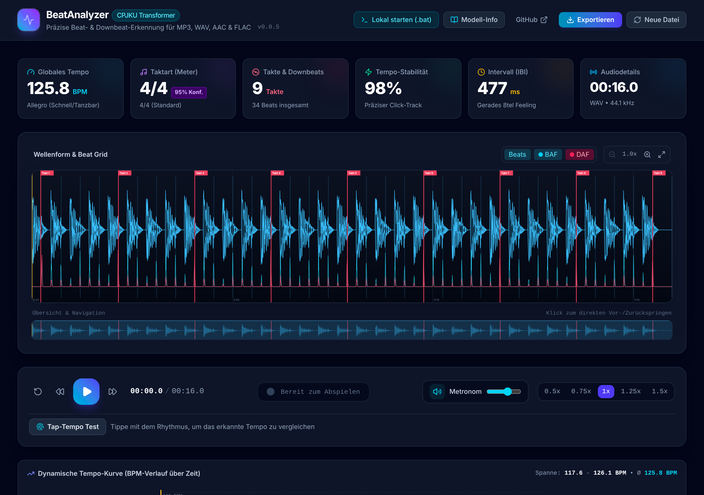
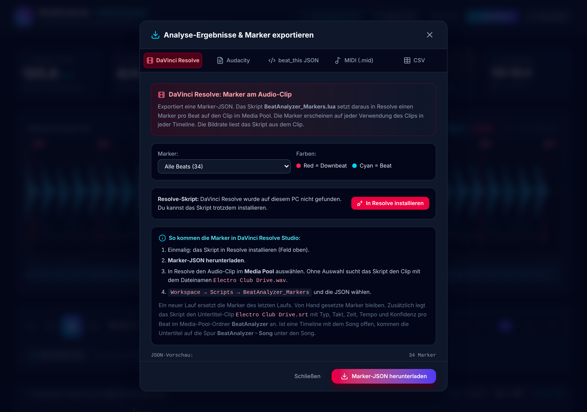

# BeatAnalyzer

**Version 0.1.4** · [Änderungen](CHANGELOG.md) · [Lizenz](LICENSE)

BeatAnalyzer erkennt in Musikdateien **Beats, Downbeats, Tempo und Taktart** und legt die Beats als **farbige Marker auf deinen Audio-Clip in DaVinci Resolve**. Die Erkennung läuft lokal auf deinem PC mit dem Transformer-Modell [CPJKU beat_this](https://github.com/CPJKU/beat_this). Die Oberfläche ist eine Web-App im Browser, der Server dahinter ist Python.



---

## Inhalt

- [Funktionen](#funktionen)
- [Voraussetzungen](#voraussetzungen)
- [Installation (Windows)](#installation-windows)
- [Installation (Linux / macOS)](#installation-linux--macos)
- [Bedienung](#bedienung)
- [Export](#export)
- [DaVinci Resolve](#davinci-resolve)
- [Update](#update)
- [Kommandozeile](#kommandozeile)
- [Fehlersuche](#fehlersuche)
- [Aufbau des Projekts](#aufbau-des-projekts)
- [Entwicklung](#entwicklung)
- [Lizenz](#lizenz)
- [Credits](#credits)

---

## Funktionen

- **Beat- und Downbeat-Erkennung** mit CPJKU beat_this (PyTorch, mit NVIDIA-Grafikkarte über CUDA). Ist beat_this nicht installiert, rechnet BeatAnalyzer mit librosa.
- **Tempo und Taktart:** globales Tempo, Durchschnitt, Median, kleinstes und größtes Tempo, Tempo-Stabilität in Prozent, Taktart (z. B. 4/4, 3/4).
- **Wellenform mit Beat-Raster:** Takte und Beats als Linien, dazu die Aktivierungskurven für Beats (BAF) und Downbeats (DAF). Zoom und Übersicht zum Springen.
- **Wiedergabe mit Metronom:** Der Klick liegt auf den erkannten Beats, der Downbeat klingt höher. Geschwindigkeit 0,5× bis 1,5×.
- **Tap-Tempo:** Im Takt mittippen und das Ergebnis mit dem erkannten Tempo vergleichen.
- **Tempo-Kurve:** BPM-Verlauf über die ganze Datei.
- **Beat-Tabelle zum Korrigieren:** jeden Beat um ±10 ms verschieben oder als Downbeat markieren. Die Korrekturen gehen in alle Exporte.
- **Export:** Marker für DaVinci Resolve, Audacity-Textspur, JSON, MIDI-Klickspur, CSV.
- **DaVinci Resolve:** Ein Lua-Skript setzt die Marker auf den Clip. BeatAnalyzer installiert das Skript selbst in Resolve.
- **Update von GitHub** mit einem Klick in der App.
- **Formate:** MP3, WAV, FLAC, AAC/M4A, OGG.

## Voraussetzungen

| Was | Version | Hinweis |
|---|---|---|
| Windows | 10 oder 11 | Linux und macOS gehen auch, siehe unten |
| Python | 3.10 bis 3.13 | Beim Installer das Häkchen bei *Add python.exe to PATH* setzen |
| Git | beliebig | Nur für beat_this nötig. Ohne Git rechnet BeatAnalyzer mit librosa |
| NVIDIA-Grafikkarte | optional | Beschleunigt beat_this. Ohne läuft es auf der CPU |
| DaVinci Resolve Studio | 21.2 | Nur für die Marker in Resolve. Die kostenlose Version sperrt den Dateizugriff für Skripte |
| Speicherplatz | ca. 5 GB | Hauptsächlich PyTorch im Ordner `venv\` |

Node.js brauchst du nicht. Die Oberfläche liegt fertig gebaut in `dist/`.

## Installation (Windows)

1. **Herunterladen:** [BeatAnalyzer.zip](https://github.com/fardem/beatanalyzer/releases/latest/download/BeatAnalyzer.zip) vom neuesten Release.
2. **Entpacken:** Rechtsklick auf die ZIP-Datei → *Alle extrahieren*. Am besten in einen Ordner ohne Umlaute und Leerzeichen, z. B. `C:\BeatAnalyzer`.
3. **Doppelklick auf `install_and_run.bat`.** Windows warnt eventuell, weil die Datei aus dem Internet kommt: *Weitere Informationen* → *Trotzdem ausführen*.

`install_and_run.bat` macht Folgendes:

- sucht Python,
- legt die Umgebung `venv\` im BeatAnalyzer-Ordner an; das übrige System bleibt unverändert,
- installiert NumPy, SciPy, librosa, soundfile, PyTorch und beat_this,
- installiert das Resolve-Skript, wenn DaVinci Resolve auf dem PC ist,
- startet den Server und öffnet <http://localhost:8000> im Browser.

Der erste Lauf dauert einige Minuten (PyTorch ist ca. 2 GB groß). Das Protokoll steht in `install_log.txt`.

**Danach** startest du BeatAnalyzer mit `start.bat`. Beenden: im schwarzen Fenster `Strg + C` oder das Fenster schließen.

**Deinstallieren:** den BeatAnalyzer-Ordner löschen. Das Resolve-Skript liegt unter `%APPDATA%\Blackmagic Design\DaVinci Resolve\Support\Fusion\Scripts\Utility\BeatAnalyzer_Markers.lua`.

## Installation (Linux / macOS)

```bash
./install_and_run.sh
```

Das Skript legt `venv/` an, installiert die Pakete aus `requirements.txt`, installiert das Resolve-Skript, wenn Resolve gefunden wird, und startet den Server auf <http://localhost:8000>.

## Bedienung

1. **Datei laden:** Audiodatei ins Fenster ziehen oder anklicken. Zum Ausprobieren gibt es Beispiel-Tracks.
2. **Ergebnis prüfen:** Die Kacheln oben zeigen Tempo, Taktart, Anzahl der Takte, Tempo-Stabilität, Beat-Abstand und Dauer.
3. **Anhören:** Play startet die Wiedergabe mit Metronom. Ein Klick in die Wellenform springt an diese Stelle.
4. **Korrigieren:** In der Beat-Tabelle einen Beat mit `-10ms` / `+10ms` verschieben oder mit `1/X` zum Downbeat machen bzw. zurücksetzen.
5. **Exportieren:** Button *Exportieren* oben rechts.

Ohne den Python-Server (z. B. nur `npm run dev`) rechnet der Browser selbst. Das Ergebnis ist dann ungenauer als mit beat_this.

## Export

| Format | Datei | Wofür |
|---|---|---|
| DaVinci Resolve | `<Name>_resolve_markers.json` | Marker am Clip in Resolve, siehe [DaVinci Resolve](#davinci-resolve) |
| Audacity | `<Name>_audacity_labels.txt` | *Datei → Importieren → Textmarken* |
| beat_this JSON | `<Name>_beat_this.json` | Alle Werte, z. B. für eigene Skripte |
| MIDI | `<Name>_click_track.mid` | Klickspur für eine DAW |
| CSV | `<Name>_beats.csv` | Tabelle mit Zeit, Takt, Zählzeit, Tempo |

## DaVinci Resolve



Das Skript `BeatAnalyzer_Markers.lua` setzt einen Marker pro Beat auf den Audio-Clip im **Media Pool**:

- **Red** = Downbeat (Zählzeit 1), Name `Bar 1`, `Bar 2`, …
- **Cyan** = übrige Beats, Name `1.2`, `1.3`, …
- In der Notiz stehen Zeit und Tempo des Beats.

Die Marker gehören zur Audiodatei. Sie erscheinen auf dem Clip in jeder Timeline, in der du ihn verwendest. Der Clip muss dafür nicht in einer Timeline liegen.

### Skript installieren

In BeatAnalyzer: *Exportieren → DaVinci Resolve → In Resolve installieren*. Das Feld zeigt auch, ob eine ältere Version installiert ist; dann heißt der Button *In Resolve aktualisieren*. `install_and_run.bat` und das Update erledigen das automatisch.

Danach Resolve einmal neu starten.

### Marker setzen

1. In BeatAnalyzer: *Exportieren → DaVinci Resolve → Marker-JSON herunterladen*. Mit *Nur Downbeats* kommt nur ein Marker pro Takt.
2. In Resolve den Audio-Clip im Media Pool auswählen. Ohne Auswahl nimmt das Skript alle Clips mit dem Dateinamen aus der JSON.
3. *Workspace → Scripts → BeatAnalyzer_Markers* und die JSON wählen.

Ein neuer Lauf löscht die Marker des letzten Laufs und setzt die neuen. Von Hand gesetzte Marker bleiben. Das Skript liest die Bildrate aus dem Clip; 23,976, 29,97 und 59,94 fps werden exakt umgerechnet. Meldungen stehen unter *Workspace → Console* in den Zeilen mit `[BeatAnalyzer]`.

Die Farben stehen oben im Skript (`DOWNBEAT_COLOR`, `BEAT_COLOR`) und lassen sich dort ändern.

### Untertitel mit Beat-Infos

Das Skript schreibt zusätzlich `<Song>.srt` in den Ordner der JSON und importiert die Datei in den Media-Pool-Ordner **BeatAnalyzer**. Jeder Beat ist ein Untertitel, der bis zum nächsten Beat steht:

```
Downbeat (1)
Takt 24 - Beat 1
01:02.880 - 89.6 BPM
Konfidenz 75%
```

Die Zeiten zählen ab Anfang der Audiodatei. Ein neuer Lauf ersetzt den Untertitel-Clip im Ordner **BeatAnalyzer**.

### Untertitel direkt in der Timeline

Ist beim Start des Skripts eine Timeline offen, in der der Song auf einer Audiospur liegt, legt das Skript die Untertitel auf die Untertitelspur **BeatAnalyzer - <Song>**, genau unter das erste Vorkommen des Songs:

- Startposition und vorne abgeschnittener Teil des Clips werden berücksichtigt. Beats außerhalb des sichtbaren Teils fallen weg.
- Ein neuer Lauf löscht die Spur **BeatAnalyzer - <Song>** und legt sie neu an.
- Resolve erlaubt nur eine aktive Untertitelspur. Die neue Spur wird aktiv, andere Untertitelspuren bleiben erhalten, werden aber deaktiviert.
- Dafür entsteht im Ordner **BeatAnalyzer** zusätzlich der Clip `<Song> (Timeline).srt`.

Liegt der Song nicht in der offenen Timeline, bleibt es beim Untertitel-Clip im Media Pool.

Das Skript prüft danach, ob der erste Untertitel am erwarteten Frame liegt. Meldet es eine Abweichung, `resolve/tools/probe_timeline.lua` nach `%APPDATA%\Blackmagic Design\DaVinci Resolve\Support\Fusion\Scripts\Utility\` kopieren, Resolve neu starten, Audio-Clip im Media Pool auswählen, *Workspace → Scripts → probe_timeline* starten und die Zeilen mit `[probe]` aus der Console schicken. Das Prüfskript speichert vorher das Projekt und entfernt seine Testspur wieder.

## Update

Gibt es auf GitHub eine neue Version, steht neben der Versionsnummer oben in der App der Button **Update x.y.z**. Alternativ `update.bat` doppelklicken.

Das Update:

- lädt `BeatAnalyzer.zip` des neuesten Releases,
- legt jede ersetzte Datei vorher in `update-backup\<alte Version>\`,
- lässt `venv\` unverändert und installiert Python-Pakete nur, wenn sich `requirements.txt` geändert hat,
- aktualisiert ein installiertes Resolve-Skript.

Danach BeatAnalyzer neu starten (`start.bat`).

**Alter Name:** Bis 0.0.4 hieß das Programm *BeatThis*. Das Update von 0.0.4 funktioniert wie gewohnt. Danach in BeatAnalyzer *Exportieren → DaVinci Resolve → In Resolve aktualisieren* klicken: Das installiert `BeatAnalyzer_Markers` und entfernt `BeatThis_Markers` aus Resolve. Bis dahin startet der alte Menüeintrag `BeatThis_Markers` das neue Skript. Marker, Untertitelspur „BeatThis - <Song>“ und alte Marker-JSONs werden beim nächsten Lauf erkannt und ersetzt; der alte Media-Pool-Ordner **BeatThis** bleibt stehen und kann gelöscht werden.

Ein Ordner, der mit `git clone` angelegt wurde, wird nicht per Update überschrieben; dort `git pull` verwenden.

## Kommandozeile

Unter Windows eine Audiodatei auf `run_cli.bat` ziehen. Oder:

```bash
venv/bin/python backend/analyze_cli.py song.mp3
```

| Option | Wirkung |
|---|---|
| `--export-json PFAD` | JSON mit allen Werten (Standard: `<Name>_beat_this.json`) |
| `--export-resolve PFAD` | Marker-JSON für Resolve (Standard: `<Name>_resolve_markers.json`) |
| `--only-downbeats` | Resolve-Marker nur auf Downbeats |
| `--export-audacity PFAD` | Audacity-Textspur |
| `--export-csv PFAD` | CSV-Tabelle |

Unter Windows heißt der Python-Pfad `venv\Scripts\python.exe`.

## Fehlersuche

| Meldung / Verhalten | Ursache | Lösung |
|---|---|---|
| „Der Befehl 'python' ist entweder falsch geschrieben …“ | Python ist nicht im PATH | Python-Installer → *Modify* → *Add Python to environment variables* |
| `/api/health` meldet „Librosa MIR Fallback“ statt beat_this | beat_this ist nicht installiert, meist fehlt Git | Git installieren, `install_and_run.bat` erneut starten |
| Jede Analyse endet mit „Analyzer-Fehler“ | Audio-Pakete fehlen im `venv\` | `install_log.txt` lesen; Ordner `venv\` löschen und `install_and_run.bat` erneut starten |
| `BeatAnalyzer_Markers` fehlt unter *Workspace → Scripts* | Resolve wurde nach der Installation nicht neu gestartet | Resolve neu starten; sonst in BeatAnalyzer *In Resolve installieren* |
| Skript meldet „No clip found“ | Kein Clip ausgewählt und kein Clip mit dem Dateinamen im Media Pool | Clip im Media Pool auswählen |
| Skript meldet „Cannot read the file“ | Kostenlose Resolve-Version oder Zugriff verweigert | Resolve Studio verwenden |
| Update meldet „Kein Release gefunden“ | Es gibt noch kein Release, oder das Repository ist privat | Bei privatem Repository die Umgebungsvariable `BEATANALYZER_GITHUB_TOKEN` mit einem Lese-Token setzen |

`debug_system.bat` schreibt einen Diagnosebericht nach `debug_report.txt` (Python, Pakete, Grafikkarte).

## Aufbau des Projekts

| Pfad | Aufgabe |
|---|---|
| `install_and_run.bat` / `.sh` | Erstinstallation und Start |
| `start.bat` | Start ohne Installation |
| `update.bat` | Update von GitHub |
| `run_cli.bat` | Analyse per Drag & Drop auf die Datei |
| `debug_system.bat` | Diagnosebericht |
| `backend/server.py` | HTTP-Server: liefert `dist/` aus, `/api/analyze`, `/api/resolve/*`, `/api/update/*` |
| `backend/analyzer.py` | Analyse mit beat_this oder librosa, Marker-JSON für Resolve |
| `backend/analyze_cli.py` | Kommandozeile |
| `backend/resolve_plugin.py` | Installiert das Resolve-Skript |
| `backend/updater.py` | Update aus dem neuesten GitHub-Release |
| `resolve/BeatAnalyzer_Markers.lua` | Skript für DaVinci Resolve |
| `resolve/BeatThis_Markers.lua` | Übergangsskript für Installationen bis 0.0.4 (alter Name); startet `BeatAnalyzer_Markers.lua` |
| `resolve/tools/probe_timeline.lua` | Prüfskript: wie Resolve die Untertitel in der Timeline platziert |
| `src/` | Oberfläche (React, TypeScript) |
| `dist/` | Gebaute Oberfläche; wird mit eingecheckt |
| `VERSION` | Versionsnummer; gilt für App, Skript und Release |

## Entwicklung

Oberfläche bauen (nach Änderungen in `src/`; `dist/` wird mit eingecheckt):

```bash
npm install
npm run build
```

Prüfen:

```bash
npm run lint
```

```bash
venv/bin/python -m unittest discover -s backend/tests -v
```

Die Tests für das Lua-Skript laufen gegen einen nachgebauten Resolve und brauchen das Paket `lupa` (`pip install lupa`); ohne `lupa` werden sie übersprungen. Sie ersetzen keinen Test in Resolve.

**Release:** Version in `VERSION`, `package.json` und `local VERSION` in `resolve/BeatAnalyzer_Markers.lua` anheben, CHANGELOG ergänzen, einen Tag mit der Versionsnummer pushen (z. B. `0.0.3`). Der Workflow `.github/workflows/release.yml` hängt dann `BeatAnalyzer.zip` an das Release.

## Lizenz

BeatAnalyzer steht unter der [MIT-Lizenz](LICENSE).

## Credits

**CPJKU beat_this** – Beat- und Downbeat-Erkennung, Johannes Kepler Universität Linz,
<https://github.com/CPJKU/beat_this>. Code und Modellgewichte stehen unter der MIT-Lizenz.
BeatAnalyzer enthält weder Code noch Modellgewichte von beat_this: `install_and_run.bat` installiert
das Paket von GitHub, beat_this lädt das Modell `final0` beim ersten Start selbst herunter.

Hinweis von beat_this: Einige der Trainingsdaten sind urheberrechtlich geschützt oder stehen unter
eingeschränkten Creative-Commons-Lizenzen. Ob das deine Nutzung betrifft, musst du selbst prüfen.

Wenn du beat_this in einer wissenschaftlichen Arbeit verwendest, zitiere bitte:

```bibtex
@inproceedings{foscarin2024beatthis,
    author = {Francesco Foscarin and Jan Schl{\"u}ter and Gerhard Widmer},
    title = {Beat this! Accurate beat tracking without {DBN} postprocessing},
    year = 2024,
    month = nov,
    booktitle = {Proceedings of the 25th International Society for Music Information Retrieval Conference (ISMIR)},
    address = {San Francisco, CA, United States},
}
```

Weitere Bibliotheken, die per pip installiert werden: PyTorch (BSD-3-Clause), librosa (ISC),
NumPy und SciPy (BSD-3-Clause), soundfile (BSD-3-Clause). Das Frontend in `dist/` enthält React,
React DOM, scheduler (MIT) und lucide-react (ISC); ihre Lizenztexte stehen in
[`dist/.vite/license.md`](dist/.vite/license.md).
