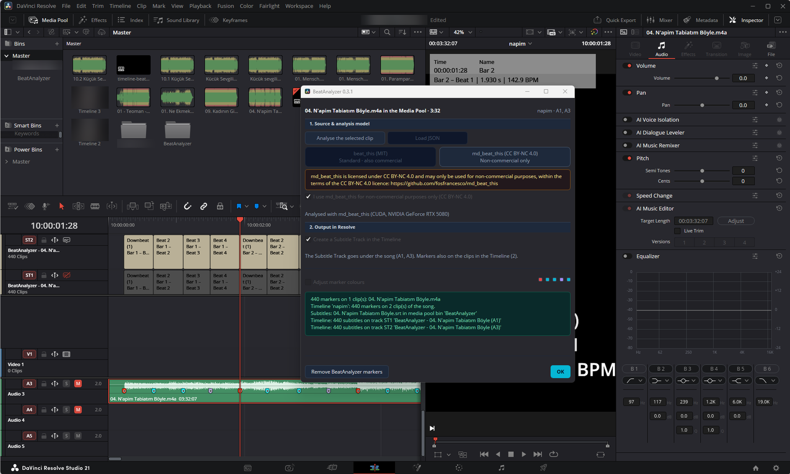
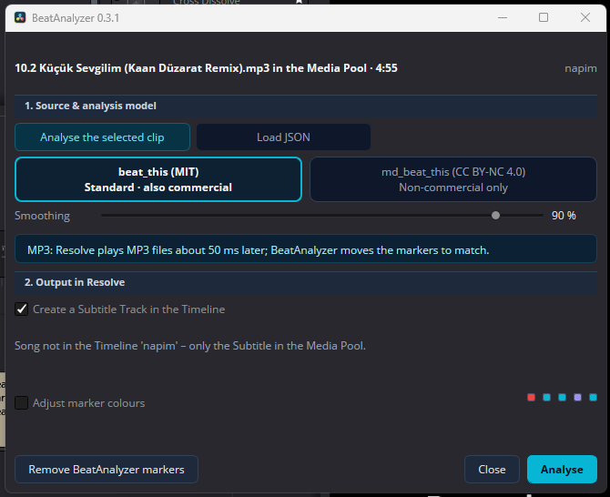
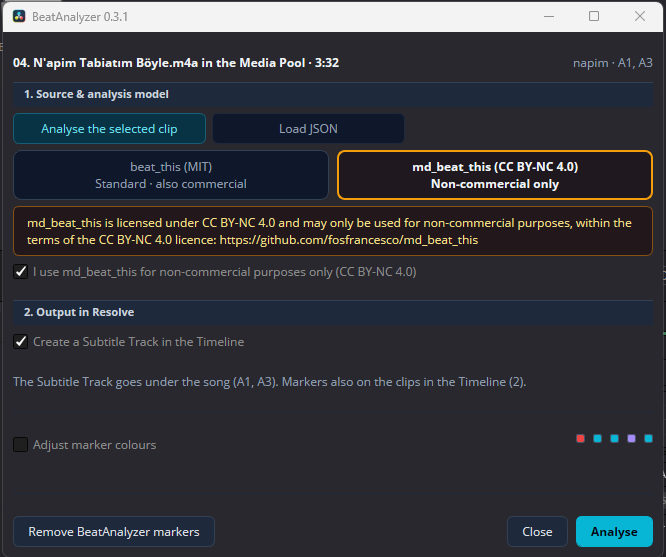
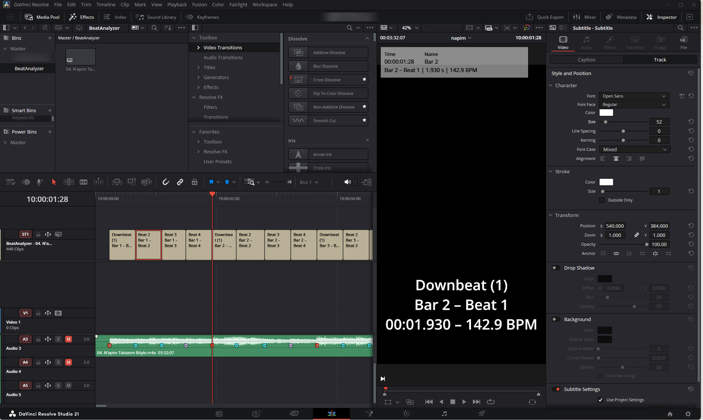
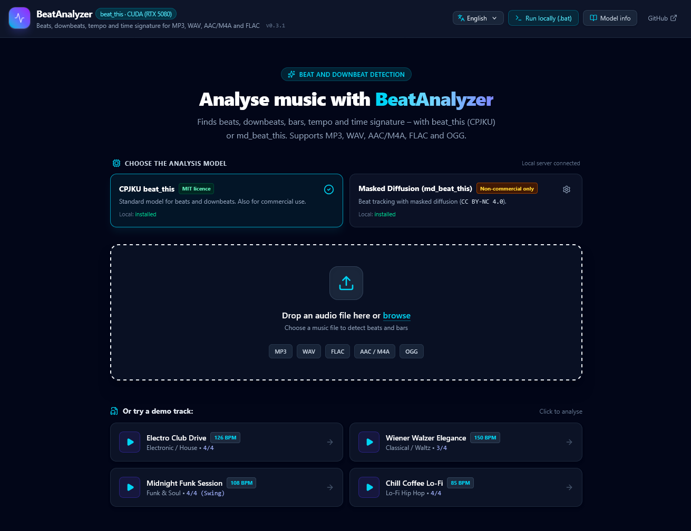
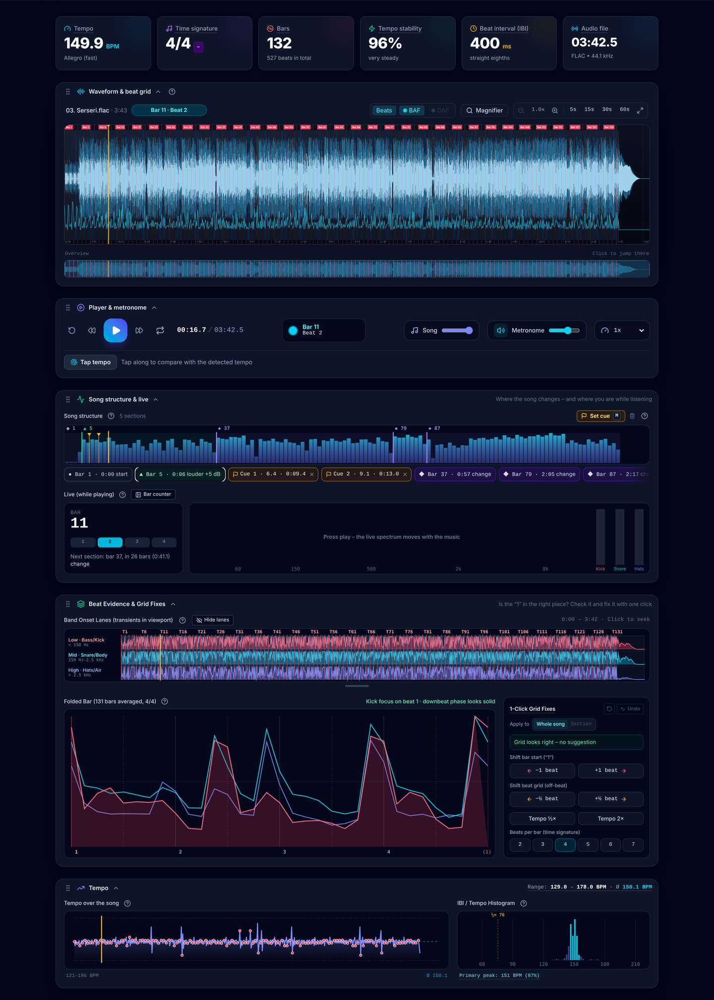
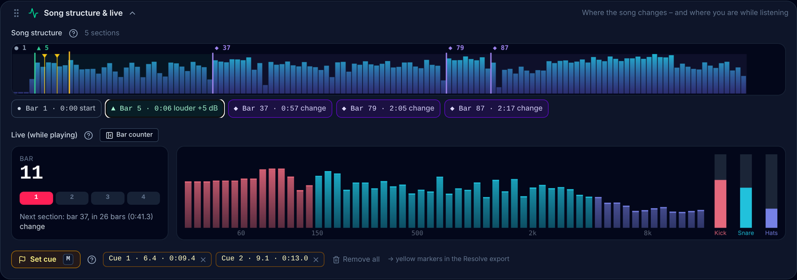

# BeatAnalyzer

**Sürüm 0.6.3** · [Değişiklikler](CHANGELOG.md) · [Lisans](LICENSE) · [English](README.md) · [Deutsch](README.de.md) · **Türkçe**

BeatAnalyzer bir şarkıdaki **beat'leri, downbeat'leri, tempoyu ve ölçüyü** bulur ve bunları **DaVinci Resolve**'a
aktarır: **ses klibinizde renkli marker'lar** ve şarkının altında bir **Subtitle Track** olarak. Analiz,
[CPJKU beat_this](https://github.com/CPJKU/beat_this) transformer modeliyle bilgisayarınızda yerel olarak çalışır.
Analizi doğrudan Resolve içindeki bir pencereden başlatabilir ya da tarayıcıdaki web uygulamasını kullanabilirsiniz.



## Neden BeatAnalyzer

- **Yalnızca beat değil, ölçü:** her beat kendi ölçüsünü ve ölçüdeki yerini bilir. Downbeat'ler doğrudan modelden
  gelir; ölçüyle birlikte, gerçekten bu ölçüye sahip ölçülerin payı da gösterilir.
- **Kontrolü sizde olan düzenli bir ölçü ızgarası:** Düzeltme, „1“i müziğin onu koyduğu yerde tutar – girişlerde ve
  break'lerde de – ve ne kadar sıkı olacağını siz seçersiniz.
- **Okunabilir marker'lar:** ölçünün her beat'i için bir renk; her marker notu ölçüyü, beat'i, zamanı, tempoyu ve
  confidence değerini söyler. Şarkının altındaki subtitle'lar kurgu sırasında aynısını gösterir.
- **Resolve'da tam isabet:** marker'lar klipte ve Timeline'daki her kullanımında, kırpılmış kliplerde de; MP3
  dosyaları Resolve'un onları çaldığı gecikme kadar kaydırılır.
- **Model sizin seçiminiz:** beat_this (MIT, ticari işler için de) veya ticari olmayan projeler için md_beat_this.
- **Kesmeden önce kontrol:** beat ızgaralı dalga formu, model eğrileri, döngü, algılanan beat'lerde metronom ve tek
  tek beat'leri düzeltmek için bir beat tablosu.
- **Izgarayı tek tıkla ayarlayın:** katlanmış ölçü kick ve snare'in ölçüde gerçekten nerede olduğunu gösterir;
  BeatAnalyzer ayarı önerir (ölçü başı, yarım beat, tempo, ölçü) – önizlemeyle, tüm şarkı veya bir bölüm için, geri
  alınabilir ve “Düzeltme” kaydırıcısı değişince korunur.
- **Şarkının nerede değiştiğini görün:** şarkı yapısı bölüm değişimlerini (daha yüksek, daha sakin, farklı) kendi
  “1”lerinde işaretler ve geri gelen kısımlara aynı harfi verir; dinlerken bir ölçü sayacı ölçüyü ve sonraki bölümün ne kadar uzakta olduğunu gösterir, **M** tuşu beat
  üzerine cue işareti koyar – ikisi de Resolve'a kendi renginde marker olarak gider.
- **Kendi görünümünüz:** ihtiyacınız olmayan panelleri daraltın ve çalıştığınız sıraya sürükleyin.
- **Yerel ve gizli:** her şey bilgisayarınızda çalışır – yükleme yok, hesap yok.

---

## İçindekiler

- [Neden BeatAnalyzer](#neden-beatanalyzer)
- [Özellikler](#özellikler)
- [Gereksinimler](#gereksinimler)
- [Kurulum (Windows)](#kurulum-windows)
- [Kurulum (Linux / macOS)](#kurulum-linux--macos)
- [DaVinci Resolve](#davinci-resolve)
- [Web uygulaması](#web-uygulaması)
- [Dışa aktarma](#dışa-aktarma)
- [Diller](#diller)
- [Güncelleme](#güncelleme)
- [Komut satırı](#komut-satırı)
- [Sorun giderme](#sorun-giderme)
- [Proje yapısı](#proje-yapısı)
- [Geliştirme](#geliştirme)
- [Modeller ve lisanslar](#modeller-ve-lisanslar)
- [Katkıda bulunanlar](#katkıda-bulunanlar)

---

## Özellikler

- CPJKU beat_this ile **beat ve downbeat algılama** (PyTorch; CUDA üzerinden NVIDIA ekran kartında ya da CPU'da).
  beat_this yoksa BeatAnalyzer librosa ile hesaplar. İsteğe bağlı ikinci model:
  [md_beat_this](https://github.com/fosfrancesco/md_beat_this) – **yalnızca ticari olmayan kullanım için**
  (CC BY-NC 4.0).
- **Doğrudan DaVinci Resolve'dan analiz:** klibi seçin, *Analiz et*'e basın – marker'lar ve subtitle'lar kendiliğinden
  gelir.
- Media Pool'daki **klipte** ve açık Timeline'daki şarkı kliplerinde **marker'lar**; ölçünün her beat'i için ayrı
  renk. Marker notu ölçüyü, beat'i, zamanı, tempoyu ve confidence değerini gösterir.
- **Şarkının altında Subtitle Track** – her beat için bir subtitle (ölçü, beat, zaman, tempo); şarkının bulunduğu her
  ses izi için bir track.
- **Düzenli ölçü ızgarası („Düzeltme“):** beat_this her downbeat'e ayrı ayrı karar verir; bu yüzden girişler ve
  break'ler 2 ya da 3 beat'lik ölçüler alabilir. Düzeltme bunların üzerine düzenli bir ızgara koyar ve yalnızca
  modelin açıkça yeni bir „1“ duyduğu yerde yeniden başlar. Beat'lerin kendisi asla değişmez.
- **Web uygulaması:** tempo, ölçü, toplam ölçü sayısı, tempo kararlılığı; beat ızgaralı ayrıntılı dalga formu ve beat
  ile downbeat eğrileri, yakınlaştırma, döngü, metronomlu oynatıcı ve tap tempo, şarkı yapısı, canlı ölçü sayacı,
  cue işaretleri (M tuşu), öneriyle ölçü ayarı, tempo eğrisi ve histogramı, düzeltmeler için beat tablosu. Paneller
  daraltılabilir ve taşınabilir.
- **Dışa aktarma:** Resolve için marker JSON, Audacity etiketleri, JSON, MIDI klik izi, CSV.
- **Biçimler:** MP3, WAV, FLAC, OGG, AAC/M4A, ALAC, Opus, WMA ve daha fazlası. MP3 dosyaları, Resolve'un onları çaldığı
  gecikme kadar (yaklaşık 50 ms) kaydırılır; böylece marker'lar beat'in üzerinde durur.
- **İngilizce, Almanca, Türkçe** – web uygulaması ve Resolve penceresi.
- Tek tıkla **GitHub'dan güncelleme**.

## Gereksinimler

| Ne | Sürüm | Not |
|---|---|---|
| Windows | 10 veya 11 | Linux ve macOS da çalışır, aşağıya bakın |
| Python | 3.10 – 3.13 | Kurulumda *Add python.exe to PATH* kutusunu işaretleyin |
| Git | herhangi | beat_this kurulumu için. Git olmadan BeatAnalyzer librosa ile hesaplar |
| NVIDIA ekran kartı | isteğe bağlı | beat_this'i belirgin şekilde hızlandırır. Sürücü CUDA 12.8 veya üstünü destekliyorsa kurulum PyTorch'un CUDA sürümünü seçer (RTX 50 kartları bunu gerektirir); olmadan CPU'da çalışır |
| DaVinci Resolve **Studio** | 21 | Yalnızca Resolve penceresi için. Ücretsiz sürüm pencereli ve dosya erişimli betiklere izin vermez ([Sorun giderme](#sorun-giderme)) |
| Disk alanı | yaklaşık 5 GB | Çoğu `venv\` klasöründeki PyTorch |

Node.js gerekmez: web uygulaması `dist/` içinde hazır derlenmiş olarak gelir.

**Test edildiği ortam:** Windows, Python 3.13, PyTorch 2.8.0+cu128, NVIDIA GeForce RTX 5080 (sürücü 621.24) ve
DaVinci Resolve Studio 21 – tüm paket sürümleri [docs/tested-environment.md](docs/tested-environment.md) dosyasında.

## Kurulum (Windows)

1. En son sürümden [BeatAnalyzer.zip](https://github.com/fardem/beatanalyzer/releases/latest/download/BeatAnalyzer.zip)
   dosyasını **indirin**.
2. **Açın:** ZIP'e sağ tıklayın → *Tümünü ayıkla*. En iyisi boşluk içermeyen bir klasör, örn. `C:\BeatAnalyzer`.
3. **`install_and_run.bat`'a çift tıklayın.** Dosya internetten geldiği için Windows uyarabilir:
   *Daha fazla bilgi* → *Yine de çalıştır*.

`install_and_run.bat`:

- Python'u arar,
- BeatAnalyzer klasöründe kendi ortamı `venv\`'i oluşturur – sisteminizin geri kalanı değişmez,
- NumPy, SciPy, librosa, soundfile, PyAV, PyTorch ve beat_this'i kurar – güncel sürücülü bir NVIDIA kartı varsa
  PyTorch'u **CUDA sürümü** olarak, yoksa CPU sürümü olarak (eski bir kurulumdaki CPU sürümü değiştirilir, çalışan
  bir CUDA sürümü korunur),
- beat_this modelini önceden indirir,
- bilgisayarda Resolve varsa betiği DaVinci Resolve'a kurar,
- sunucuyu başlatır ve hazır olur olmaz <http://localhost:8000> adresini açar.

İlk çalıştırma birkaç dakika sürer (PyTorch yaklaşık 2 GB). Kayıt `install_log.txt` dosyasındadır.

**Sonrasında** BeatAnalyzer'ı `start.bat` ile başlatın. Durdurmak için siyah pencerede `Ctrl + C`'ye basın ya da
pencereyi kapatın.

**Kaldırma:** BeatAnalyzer klasörünü silin. Resolve betiği şuradadır:
`%APPDATA%\Blackmagic Design\DaVinci Resolve\Support\Fusion\Scripts\Utility\BeatAnalyzer_Markers.lua`.

## Kurulum (Linux / macOS)

```bash
./install_and_run.sh
```

Betik `venv/` oluşturur, `requirements.txt` içindeki paketleri kurar, Resolve bulunursa Resolve betiğini kurar ve
sunucuyu <http://localhost:8000> adresinde başlatır.

## DaVinci Resolve

### Betiği kurma

`install_and_run.bat` ve her güncelleme betiği kendiliğinden kurar. Web uygulamasından da yapılabilir:
*Dışa aktar → DaVinci Resolve → Resolve'a kur* (eski bir sürüm kuruluysa *Resolve'da güncelle*). Ardından Resolve'u
bir kez yeniden başlatın.

Açmak için: **Workspace → Scripts → BeatAnalyzer_Markers**.

### Pencere



En üstte şarkı ve açık Timeline görünür. Altında:

**1. Kaynak ve analiz modeli** – iki yol:

- **Seçili klibi analiz et:** Media Pool'da bir ses klibi seçin ve **Analiz et**'e basın. Analiz arka planda çalışır;
  marker'lar eklenmeye başlayana kadar iptal edebilirsiniz. O ana kadar projenizde hiçbir şey değişmez.
- **JSON yükle:** web uygulamasından dışa aktarılmış bir marker JSON dosyası seçin ve **Marker'ları ekle**'ye basın.

**Modeli** seçin: *beat_this (MIT)* – standart, ticari işler için de – veya *md_beat_this (CC BY-NC 4.0)* – yalnızca
ticari olmayan kullanım. md_beat_this seçildiğinde pencere lisansı gösterir; analiz edebilmek için kutuyu
işaretlemeniz gerekir:



**Düzeltme** (%0 = kapalı … %100, varsayılan %90) ölçülerin ne kadar düzenli yerleştirileceğini belirler
([Özellikler](#özellikler)). md_beat_this kare başına olasılık vermediği için orada kaydırıcı gizlidir.

> **Güçlü rubato, free jazz, sabit ölçüsü olmayan müzik: Düzeltme'yi %0 yapın.** Düzeltme (arka uçta `smooth_bars`,
> `REANCHOR_PENALTY` ile bir Viterbi geçişi) oldukça sabit bir ızgarası olan popüler müzik için yapılmıştır: tam
> ölçüleri saymaya devam eder ve ızgarayı yalnızca model açıkça yeni bir „1“ duyduğunda yeniden başlatır. Güçlü
> rubatolu klasik müzikte, free jazz'da ya da sabit ölçüsü olmayan müzikte bu, müzikte olmayan yerlere ölçü çizgisi
> koyabilir. %0 ile ölçüler modelin downbeat'lerini olduğu gibi izler (komut satırı: `--no-smooth-bars`). Düzeltme
> beat'lerin kendisini asla kaydırmaz – ama bu tür müzikte beat tanıma da daha az emindir; sonucu kulakla kontrol
> edin. BeatAnalyzer türü tahmin etmez; siz karar verirsiniz.

**2. Resolve'daki çıktı**

- **Timeline'da Subtitle Track oluştur:** şarkı açık Timeline'ın bir ses izindeyse, altına „BeatAnalyzer -
  &lt;şarkı&gt;“ adlı bir Subtitle Track eklenir – şarkının bulunduğu her ses izi için bir tane.
- **Marker renklerini ayarla:** downbeat, beat 2, 3, 4 ve diğer beat'ler için birer renk – ya da marker yok – ve web
  uygulamasından gelen cue işaretleri ile bölüm değişimleri için (varsayılan sarı ve mor). Küçük kareler geçerli
  renkleri gösterir. İlk marker'ın notu BeatAnalyzer'ı ve sürümünü belirtir.

**Notlar** renkli kutularda görünür: bilgi için mavi (örn. MP3 gecikmesi), md_beat_this lisansı ve sorular için
kehribar, hatalar için kırmızı, sonuç için yeşil.

**BeatAnalyzer marker'larını kaldır**, sorduktan sonra BeatAnalyzer'ın marker'larını, Subtitle Track'lerini ve
subtitle kliplerini kaldırır. Elle eklediğiniz marker'lar kalır.

Pencere yolu, modeli, düzeltmeyi ve renkleri hatırlar. md_beat_this lisans kutusu her seferinde yeniden sorulur.

### Sonuç



- **Media Pool'daki ses klibinde marker'lar** – klibin her Timeline'daki her kullanımında görünür – ve açık
  Timeline'daki şarkı kliplerinde, baştan kırpılmış kliplerde de. Varsayılan renkler: **kırmızı** = downbeat,
  **cyan** = beat 2–4. Marker notu örneğin şöyledir: `Ölçü 2 – Beat 1 | 1,930 s | 142,9 BPM`.
- **Subtitle'lar:** Media Pool'daki **BeatAnalyzer** klasöründe `<şarkı>.srt` dosyası ve Subtitle Track üzerinde her
  beat için bir subtitle:

  ```
  Downbeat (1)
  Ölçü 2 – Beat 1
  00:01,930 – 142,9 BPM
  ```

  İlk subtitle dosyayı, tempoyu, ölçüyü, modeli ve lisansını belirtir.
- Yeni bir çalıştırma, önceki çalıştırmanın marker'larının ve track'lerinin yerini alır.

**MP3:** Resolve çoğu MP3 dosyasını analiz edildiğinden yaklaşık 50 ms geç çalar (baştaki kodlayıcı gecikmesini
atlamaz). BeatAnalyzer kesin gecikmeyi dosyadan okur ve marker'larla subtitle'ları bu kadar kaydırır; pencere bunu
önce ve sonra gösterir. Bu gecikmesi olmayan MP3 dosyalarında düzeltme gerekmez – pencere bunu da söyler.

## Web uygulaması

`start.bat`, web uygulamasını <http://localhost:8000> adresinde açar.



1. **Modeli seçin** – beat_this veya md_beat_this (oturum başına bir kez lisans onayı ister).
2. **Bir ses dosyası sürükleyin** ya da *göz atın*'a tıklayın. Üst satır hangi programla analiz edildiğini gösterir,
   örn. `beat_this · CUDA (RTX 5080)`.
3. **Sonucu kontrol edin:**



- **Görünümünüz:** kutucukların altındaki her panel başlığına tıklayınca daralır ve tutamağından (⋮⋮ ya da üzerinde
  ok tuşları) sürüklenerek taşınır; web uygulaması düzeni hatırlar. *Görünümü sıfırla* varsayılan sırayı geri getirir.
- **Kutucuklar:** tempo, ölçü (bu ölçüdeki ölçülerin payıyla), toplam ölçü, tempo kararlılığı, ızgara sapmasıyla beat aralığı (± ms:
  yaklaşık 10 ms'nin altında marker'lar kare kare doğru oturur), ses dosyası. Ölçü kutucuğundaki **Düzeltme** kaydırıcısı ölçüleri hemen yeniden hesaplar.
- **Dalga formu ve beat ızgarası:** çizgi olarak ölçüler ve beat'ler, modelin beat (BAF) ve downbeat (DAF) eğrileri.
  Hızlı yakınlaştırma 5 s / 15 s / 30 s / 60 s (çift tık: yüklemede varsayılan), büyüteç, sürüklenebilir çerçeveli genel görünüm.
- **Oynatıcı:** istenen yerden çalma, **döngü** (gri = kapalı, sarı A-B = mavi çerçevedeki bölüm, yeşil = tüm
  şarkı), şarkının ses düzeyi (yanındaki hoparlör şarkıyı susturur – yalnızca metronom), algılanan beat'lerde örnek hassasiyetinde **metronom** (downbeat'te daha yüksek tık), hız 0,5× – 1,5×,
  tap tempo.
- **Şarkı yapısı ve canlı:** her ölçü diğer tüm ölçülerle karşılaştırılır – notalarına (akorlar), ses rengine
  (enstrümanlar) ve ses seviyesine göre; bölüm değişimleri (▲ daha yüksek, ▼ daha sakin, ◆ farklı) kendi “1”lerinde
  durur ve geri gelen kısımlar aynı harfi alır (A, B, A, B, C …) – tıklayınca oraya atlar, bölüm düğmeleri fare basılıyken kaydırılabilir.
  Çalarken: bir ölçü sayacı (geçerli ölçü ve beat, sonraki bölüm; gizlenebilir) ve canlı spektrum (her beat'te
  parlama, “1”de daha güçlü). **M** – ya da “Şarkı yapısı” başlığının sağındaki *Cue koy* – en yakın beat'e bir
  cue işareti koyar (Shift+M: en yakın “1”e); cue'lar bölümlerin arasında sarı düğme olarak durur. Cue işaretleri ve
  bölüm değişimleri Resolve dışa aktarımına sarı ve mor marker olarak, Audacity etiketlerine de girer.



- **Beat kanıtları ve ölçü ayarı:** kick (< 150 Hz), snare/gövde ve hi-hat için şeritler, dalga formunun
  yakınlaştırmasıyla birlikte (altındaki tutamaçla iki kat yüksekliğe kadar sürüklenebilir); **katlanmış ölçü** tüm
  ölçüleri – bölümün veya tüm şarkının – üst üste koyar ve kick'in “1”de olup olmadığını söyler. **Tek tıkla
  ayar:** ölçü başı ±1 beat, ızgara ±½ beat, tempo ½× / 2×, **ölçü başına beat** (2–7); geri alma ve sıfırlama.
  Bir **öneri** bu ayarları katlanmış ölçüde dener ve en iyisini kesikli bir önizlemeyle sunar – *Uygula* onu alır.
  Ayarlar **tüm şarkıya veya yalnızca mavi çerçevedeki bölüme** uygulanır (örn. ½× yalnızca modelin çift saydığı
  yerde). “Düzeltme” kaydırıcısı değişince korunur ve tüm dışa aktarımlara – Resolve için marker JSON'a da – gider.
- **Tempo:** tüm şarkı boyunca tempo eğrisi ve yanında her temponun ne sıklıkla geçtiği (½× / 2× işaretleri) –
  sabit bir ızgara düz bir çizgi ve tek yüksek bir çubuk olarak görünür. Tempo sabitken daraltılmış.
- **Beat tablosu:** bir beat'i ±10 ms kaydırın, downbeat yapın (`1/X`), modelin kaçırdığı bir beat'i **ekleyin** (+)
  ya da fazladan olanı **silin** (çöp kutusu); dalga formunda 30 sn veya daha az görünürken: **Shift+tık** ekler,
  **Alt+tık** siler. Tüm düzeltmeler geri alınabilir, Düzeltme kaydırıcısıyla korunur ve tüm dışa aktarımlara gider.

4. **Dışa aktar** – sağ üstteki düğme.

Python sunucusu olmadan (örn. yalnızca `npm run dev`) tarayıcı kendisi hesaplar ve bunu görünür bir notla belirtir
– sonuç beat_this'e göre çok daha az doğrudur.

## Dışa aktarma

| Biçim | Dosya | Ne için |
|---|---|---|
| DaVinci Resolve | `<ad>_resolve_markers.json` | Resolve penceresindeki *JSON yükle* yolu |
| Audacity | `<ad>_audacity_labels.txt` | *File → Import → Labels* |
| beat_this JSON | `<ad>_beat_this.json` | tüm değerler, örn. kendi betikleriniz için |
| MIDI | `<ad>_click_track.mid` | DAW için klik izi, tempo haritasıyla: her klik kendi beat'inde, ölçüler şarkıyı izler |
| CSV | `<ad>_beats.csv` | zaman, ölçü, beat, tempo tablosu |

## Diller

Web uygulaması ve Resolve penceresi **İngilizce, Almanca ve Türkçe** konuşur. Dili web uygulamasının üst satırında
seçin; dil kaydedilir ve Resolve penceresi için de geçerlidir (bir kez *Resolve'da güncelle*'ye tıklayın ve Resolve'u
yeniden başlatın). Resolve'un Türkçe arayüzü olmadığından Resolve terimleri (marker, Subtitle Track, Media Pool …) ve
*beat, downbeat, confidence* her dilde İngilizce kalır. Programın verdiği diğer tüm çıktılar (sunucu, konsol, komut
satırı, betikler) İngilizcedir.

## Güncelleme

GitHub'da yeni bir sürüm varsa web uygulamasının üst satırında **Güncelle x.y.z** düğmesi görünür. Ya da
`update.bat`'a çift tıklayın.

Güncelleme:

- en son sürümün `BeatAnalyzer.zip` dosyasını indirir,
- değiştirilen her dosyayı `update-backup\<eski sürüm>\` içinde saklar,
- `venv\`'e dokunmaz; Python paketlerini yalnızca `requirements.txt` değiştiyse kurar,
- kurulu bir Resolve betiğini günceller.

Ardından BeatAnalyzer'ı yeniden başlatın (`start.bat`). `git clone` ile oluşturulmuş bir klasörün üzerine yazılmaz;
orada `git pull` kullanın.

## Komut satırı

Windows'ta bir ses dosyasını `run_cli.bat` üzerine sürükleyin. Ya da:

```bash
venv/bin/python backend/analyze_cli.py song.mp3
```

| Seçenek | Etkisi |
|---|---|
| `--export-json YOL` | tüm değerlerle JSON (varsayılan: `<ad>_beat_this.json`) |
| `--export-resolve YOL` | Resolve için marker JSON (varsayılan: `<ad>_resolve_markers.json`) |
| `--only-downbeats` | Resolve marker'ları yalnızca downbeat'lerde |
| `--export-audacity YOL` | Audacity etiket izi |
| `--export-csv YOL` | CSV tablosu |
| `--model beat_this\|md_beat_this` | analiz modeli (`md_beat_this` yalnızca ticari olmayan, CC BY-NC 4.0) |
| `--no-smooth-bars` | ölçüler beat_this'in verdiği gibi (düzeltme yok) |
| `--protect 0…1` | düzeltme gücü (varsayılan 0.95 ≈ pencerede %90) |
| `--ffmpeg-dir YOL` | `PATH`'te değilse `ffmpeg` içeren klasör |

Windows'ta Python yolu `venv\Scripts\python.exe`'dir.

## Sorun giderme

| Mesaj / davranış | Neden | Çözüm |
|---|---|---|
| "'python' is not recognized …" | Python PATH'te değil | Python kurulumu → *Modify* → *Add Python to environment variables* |
| Bilgisayarda NVIDIA kartı olduğu hâlde üst satırda „beat_this · CPU“ | PyTorch'un CPU sürümü kurulu (eski kurulum) | `install_and_run.bat`'ı yeniden çalıştırın: CUDA sürümünü kurar. Belirli bir sürümü korumak için önce `set BEATANALYZER_TORCH=cpu` (veya `cu126`, `cu128`) |
| Üst satırda „librosa (fallback) – beat_this not installed“ | beat_this eksik, genellikle Git olmadığı için | Git'i kurun, `install_and_run.bat`'ı yeniden çalıştırın |
| *Workspace → Scripts* altında `BeatAnalyzer_Markers` yok | kurulumdan sonra Resolve yeniden başlatılmadı | Resolve'u yeniden başlatın; ya da web uygulamasında *Resolve'a kur* |
| Resolve penceresinde „Python of BeatAnalyzer not found“ | betik kurulmak yerine elle kopyalandı | web uygulamasında *Resolve'da güncelle* (BeatAnalyzer klasörünü ve Python'u betiğe yalnızca kurulum yazar) |
| Resolve'da hiçbir şey olmuyor (ücretsiz sürüm) | ücretsiz Resolve betik pencerelerine ve dosya erişimine izin vermiyor | DaVinci Resolve Studio kullanın |
| „… FLAC dosyası bir ID3 etiketiyle başlıyor“ | bir etiketleme programı FLAC verisinin önüne MP3 etiketi yazmış; tarayıcılar ve Resolve bu dosyaları reddeder | etiketi kaldırın, örn. `ffmpeg -i "song.flac" -map 0 -c copy yeni.flac` |
| Güncelleme „No release found“ diyor | henüz sürüm yok veya depo özel | özel depoda `BEATANALYZER_GITHUB_TOKEN` değişkenine okuma token'ı atayın |

`debug_system.bat`, `debug_report.txt` dosyasına bir tanılama raporu yazar (Python, paketler, ekran kartı).

## Proje yapısı

| Yol | Görevi |
|---|---|
| `install_and_run.bat` / `.sh` | ilk kurulum ve başlatma |
| `start.bat` | kurulum olmadan başlatma |
| `update.bat` | GitHub'dan güncelleme |
| `run_cli.bat` | dosyayı üzerine sürükleyerek analiz |
| `debug_system.bat` | tanılama raporu |
| `backend/server.py` | HTTP sunucusu: `dist/`'i sunar, `/api/analyze`, `/api/settings`, `/api/resolve/*`, `/api/update/*` |
| `backend/analyzer.py` | beat_this, md_beat_this veya librosa ile analiz; ölçü düzeltme; Resolve için marker JSON |
| `backend/resolve_job.py` | Resolve penceresinin başlattığı analiz |
| `backend/mp3_offset.py` | Resolve'un bir MP3'ü çaldığı gecikme |
| `backend/analyze_cli.py` | komut satırı |
| `backend/resolve_plugin.py` | Resolve betiğini kurar (dil, klasör, Python) |
| `backend/updater.py` | en son GitHub sürümünden güncelleme |
| `backend/torch_setup.py` | doğru PyTorch sürümünü kurar (CUDA veya CPU) |
| `lang/*.json` | İngilizce, Almanca ve Türkçe metinler (web uygulaması ve Resolve penceresi) |
| `resolve/BeatAnalyzer_Markers.lua` | DaVinci Resolve betiği ve penceresi |
| `src/` | web uygulaması (React, TypeScript) |
| `src/utils/beatEvidence.ts` | bant eğrileri, katlanmış ölçü, tempo histogramı (web uygulaması) |
| `src/utils/songStructure.ts` | şarkı yapısı: ölçü başına seviye, bir “1” üzerinde bölüm değişimleri (web uygulaması) |
| `src/utils/panelLayout.ts` | panellerin sırası ve açık/kapalı durumu (web uygulaması) |
| `src/utils/beatTransforms.ts` | tekrar uygulanabilir adımlar olarak tek tıkla ayarlar, bir bölüm için de (web uygulaması) |
| `src/utils/fixSuggestion.ts` | öneri: ayarları katlanmış ölçüde dener (web uygulaması) |
| `dist/` | derlenmiş web uygulaması; depoya eklenir |
| `VERSION` | uygulama, betik ve sürüm için sürüm numarası |

## Geliştirme

`src/` veya `lang/` içindeki değişikliklerden sonra web uygulamasını derleyin (`dist/` depoya eklenir):

```bash
npm install
npm run build
```

Denetimler:

```bash
npm run lint
```

```bash
npm test
```

```bash
venv/bin/python -m unittest discover -s backend/tests -v
```

Lua betiğinin testleri taklit bir Resolve'a karşı çalışır ve `lupa` paketini gerektirir (`pip install lupa`);
olmadan atlanırlar. Resolve'daki bir testin yerini tutmazlar.

**Sürüm çıkarma:** `VERSION`, `package.json`, `package-lock.json`, README dosyaları ile
`resolve/BeatAnalyzer_Markers.lua` ve `resolve/BeatThis_Markers.lua` içindeki `local VERSION` değerini yükseltin,
CHANGELOG'a ekleyin, sürüm numarasıyla bir etiket gönderin (örn. `0.3.1`). `.github/workflows/release.yml` iş akışı
`BeatAnalyzer.zip` dosyasını sürüme ekler.

## Modeller ve lisanslar

BeatAnalyzer'ın kendisi **hiçbir model içermez** ve indirme için model sunmaz:

- `install_and_run.bat`, **beat_this** Python paketini GitHub'dan kurar (<https://github.com/CPJKU/beat_this>).
- beat_this, `final0` modelini **doğrudan sağlayıcısından** (Johannes Kepler Üniversitesi Linz sunucuları) PyTorch
  önbelleğine indirir (`%USERPROFILE%\.cache\torch\hub\checkpoints\beat_this-final0.ckpt`). `install_and_run.bat`
  bu indirmeyi önceden başlatır ve başarısız olursa nedenini söyler.
- BeatAnalyzer **modeli değiştirmez**; beat_this'in verdiği olasılıkları kullanır ve ölçüleri bunlardan yerleştirir
  (Düzeltme).

| Model | Lisans | Ticari kullanım |
|---|---|---|
| beat_this (`final0`), kod ve yayımlanan ağırlıklar | MIT | izinli |
| md_beat_this (isteğe bağlı, elle kurulur) | CC BY-NC 4.0 | **izinli değil** |
| librosa (beat_this yoksa yedek) | ISC | izinli |

beat_this yazarlarının notu: eğitim verilerinin bir kısmı telif hakkıyla korunmaktadır ya da kısıtlı Creative Commons
lisanslarına tabidir. Bunun kullanımınızı etkileyip etkilemediğini kendiniz kontrol etmelisiniz. Bu özet hukuki
tavsiye değildir.

BeatAnalyzer'ın her subtitle dosyası modeli ve lisansını belirtir, örn.
„Model: beat_this – MIT lisansı kapsamında kullanım“.

### md_beat_this (isteğe bağlı, yalnızca ticari olmayan kullanım)

BeatAnalyzer, md_beat_this'in **ne kodunu ne de ağırlıklarını** içerir ve onu indirmez. Ticari olmayan amaçlarla
kullanmak isteyen, onu BeatAnalyzer ortamına kurar (ayrıca `ffmpeg` gerekir; klasörünü web uygulamasında veya
`--ffmpeg-dir` ile belirtebilirsiniz):

```bash
venv\Scripts\pip install https://github.com/fosfrancesco/md_beat_this/archive/main.zip
```

Linux / macOS'ta:

```bash
venv/bin/pip install https://github.com/fosfrancesco/md_beat_this/archive/main.zip
```

Ardından BeatAnalyzer'ı yeniden başlatın. md_beat_this sonuçları, JSON dosyalarında ve subtitle'larda lisansı ve
atfı taşır.

## Katkıda bulunanlar

**CPJKU beat_this** – beat ve downbeat algılama, Johannes Kepler Üniversitesi Linz,
<https://github.com/CPJKU/beat_this>. Kod ve model ağırlıkları MIT lisansı altındadır. beat_this'i bilimsel bir
çalışmada kullanırsanız lütfen şöyle atıf yapın:

```bibtex
@inproceedings{foscarin2024beatthis,
    author = {Francesco Foscarin and Jan Schl{\"u}ter and Gerhard Widmer},
    title = {Beat this! Accurate beat tracking without {DBN} postprocessing},
    year = 2024,
    month = nov,
    booktitle = {Proceedings of the 25th International Society for Music Information Retrieval Conference (ISMIR)},
    address = {San Francisco, CA, United States},
}
```

**Masked Diffusion (md_beat_this, isteğe bağlı)** – Francesco Foscarin, Filip Korzeniowski, Richard Vogl,
<https://github.com/fosfrancesco/md_beat_this>. Kod, ağırlıklar, tahminler ve aktivasyonlar **CC BY-NC 4.0**
altındadır (atıfla ticari olmayan kullanım).

pip ile kurulan diğer kütüphaneler: PyTorch (BSD-3-Clause), librosa (ISC), NumPy ve SciPy (BSD-3-Clause),
soundfile (BSD-3-Clause), PyAV (BSD-3-Clause; FFmpeg kütüphanelerini getirir, LGPL). `dist/` içindeki web uygulaması
React, React DOM, scheduler (MIT) ve lucide-react (ISC) içerir; lisans metinleri
[`dist/.vite/license.md`](dist/.vite/license.md) dosyasındadır.

BeatAnalyzer [MIT lisansı](LICENSE) altındadır.
